# キッズホーム 🐰🐱

子ども用タブレット（ALLDOCUBE iPlay60 など）向けの、かわいいホーム画面アプリです。

へや の ホーム

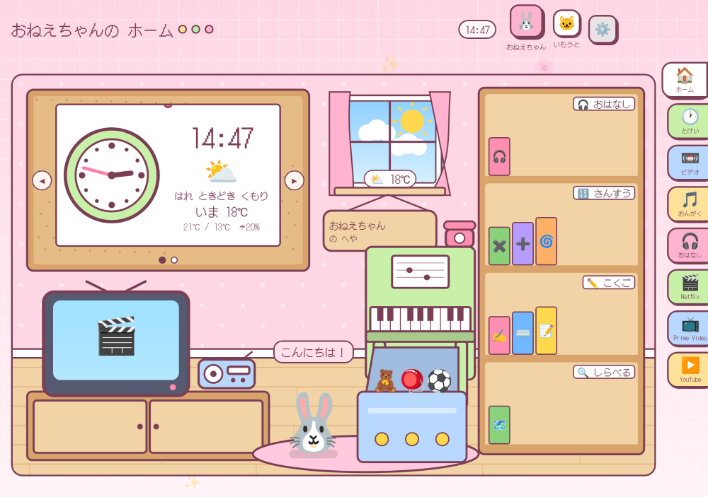

| タブ式ホーム（うさぎ） | どうがロック中（おほしさま） |
| --- | --- |
| 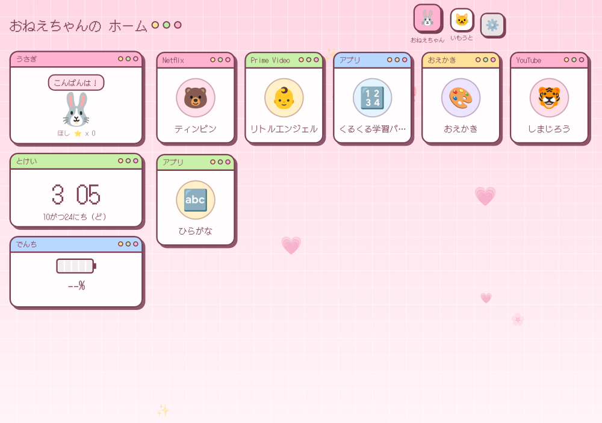 | 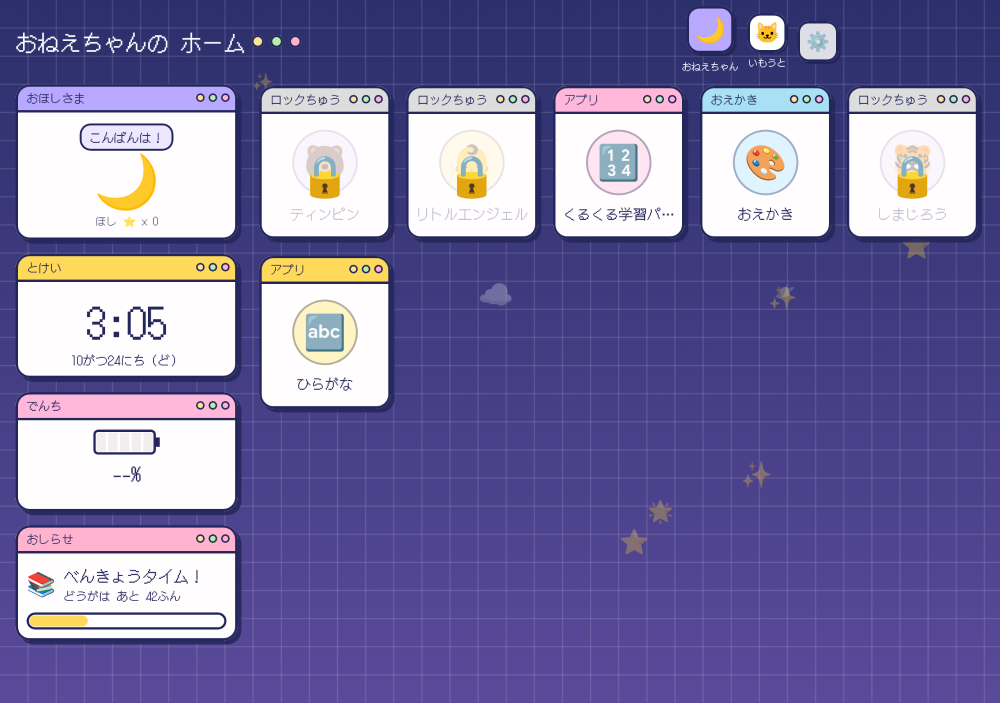 |

| とけい・カレンダー・てんき | おえかき |
| --- | --- |
| 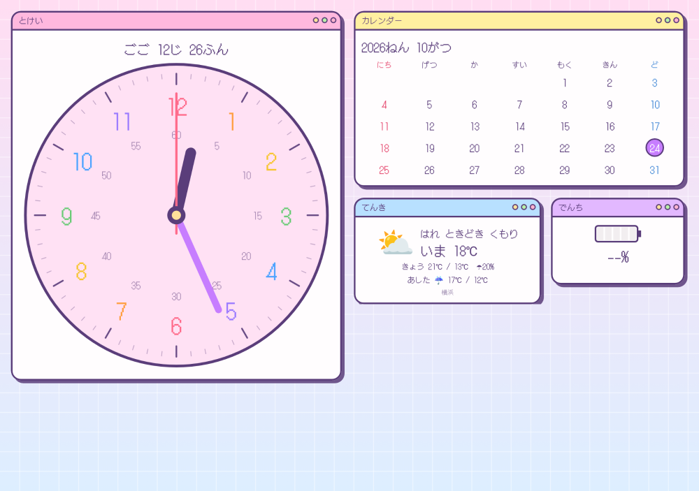 | 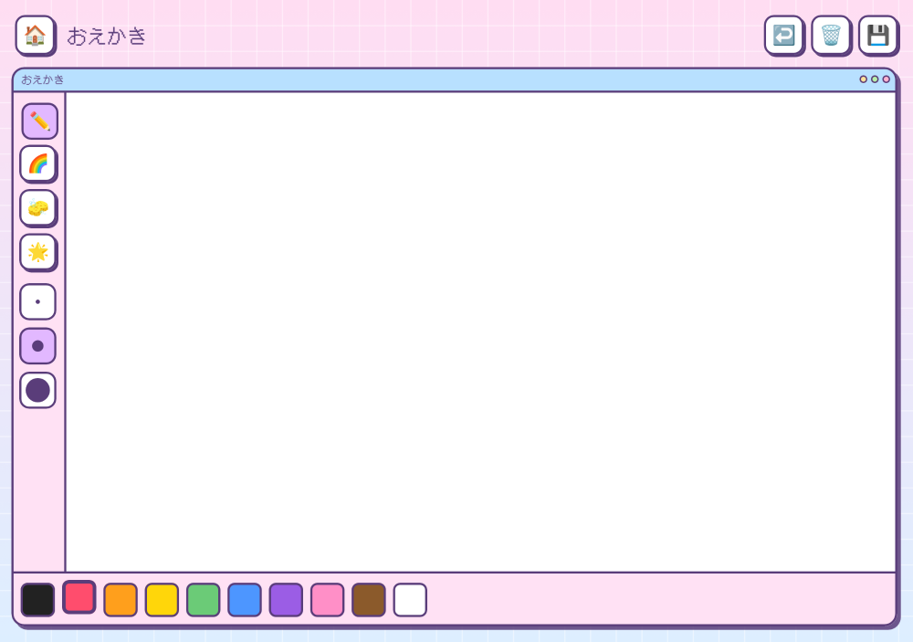 |

| おうちのひとからの呼びかけ | おうちのひと かくにん |
| --- | --- |
| 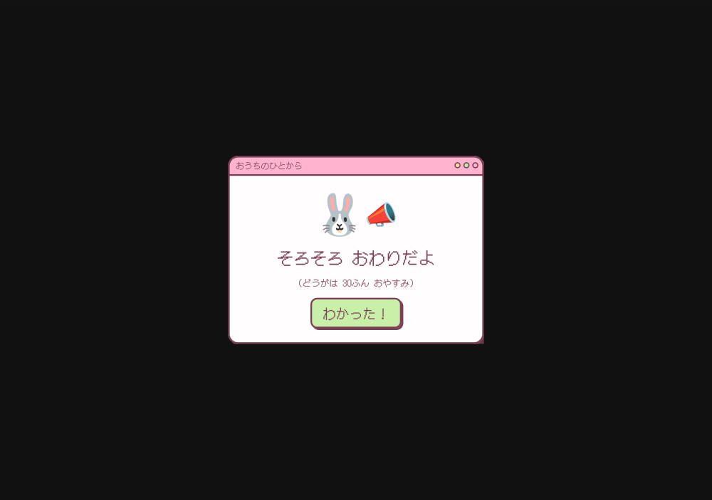 | 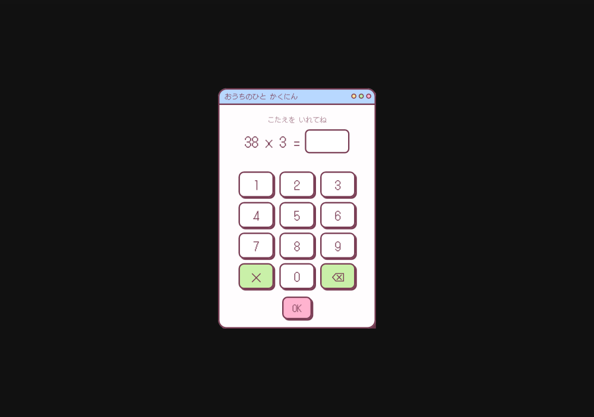 |

## できること

- **画面の右はしのタブ**
  - 🏠 ホーム：アプリ・おえかき・でんわのボタン、マスコット、カレンダー（つき／しゅう、端末の予定つき）、おんがくの ⏮ ⏯ ⏭
  - 📼 ビデオ・🎵 おんがく・🎧 おはなし：本体と SD カードの動画・音楽・オーディオブックを、サムネイルで選んでホームの中で再生
  - 🗂 仕分けたカテゴリー（べんきょう・あそび…）：その子に見せるカテゴリーだけ
  - 🕐 とけい：アナログ時計（ごぜん／ごご・ふん の数字つき）、カレンダー、てんき（Open-Meteo）、でんち
  - 🎬 動画サービスごと（Netflix・Prime Video・YouTube…）：ピン留めした作品と「アプリをひらく」
  - 🧩 ウィジェット：Android のウィジェットを置ける（置いたときだけ出る）
- **📞 でんわボタン**：Google Meet などの通話リンクを置ける（どうがロック中も使える）
- **📣 おうちのひとからの呼びかけ**：スマホのブラウザから「そろそろ おわりだよ」を送ると、動画を見ていてもキッズホームが前に出てマスコットが知らせる。`/lock 30 ごはんだよ` でロックも
- **キャラクターテーマ**：うさぎ / ねこ / くま / きょうりゅう / ユニコーン / うみ / おほしさま
- **こどもごとのホーム**：画面右上のアイコンをタップで切り替え（最大4人）
- **お気に入り動画を直接起動**：Netflix・Prime Video・YouTube・Disney+・TVer などの作品URLをボタンにできる
- **アプリの登録**：くるくる学習パッドなど、使わせたいアプリだけを並べる
- **がっき**（内蔵）：上に ミニけんばん（2 オクターブ、ドレミの色つき）、下に ドラムパッド 8 こ。けんばんは ピアノ／オルゴール／オルガン／もっきん／シンセ、ドラムは ドラム／でんし／たのしい に切り替え。いくつ同時に押しても、指をすべらせても鳴る（音はアプリの中で計算して作る）
- **おえかき**（内蔵）：画材（ペン・いろえんぴつ・クレヨン・すいさい・あぶらえ・スプレー・ゆび・にじ・けしごむ）とスタンプ。描いたものは自動で保存して 📂 から開いて つづきを描ける。🖼️ 写真の上に描く、✨ 写真を Gemini で ぬりえ・クレヨン・すいさい・まんが の絵にしてから描く。🖊️ ペンモード（スタイラスだけで描く・手のひらは無視・筆圧・ペンのおしりで消す）、🖨️ 印刷、💾 写真に保存、📌 ホームに ふせん として貼る
- **わーぷろ**（内蔵）：大きな文字、色・大きさ・紙（むじ・せん・ます）・ドット字、えもじ、🎤 こえ入力、📌 ふせん、🖨️ 印刷、自動保存
- **パズル**（内蔵）：写真・えほんの絵をピースにして はめる（4〜24 ピース、🔄 回転あり、👻 見本の表示）
- **タイピング**（内蔵）：物理キーボードでローマ字入力の練習（特打のように、つぎのキーが光り、押す指を色で教える）。📖 ローマじ ひょう、ホームポジション・あいうえお・どうぶつ・たべもの・のりもの・みじかい ぶん
- **もじ れんしゅう**（内蔵）：マスに ペンで書く（お手本は よこに小さく・田の点線・筆圧・ペンモード）。書いた字は 1 字ずつ保存され、いつのまにか その子の **手書きフォントの素材** が集まる。学年に合わせて漢字が増える（4 月に自動で 1 つ上がる）
- **ふせん**：おえかき・わーぷろ から ホームに貼れる。指で動かす、タップで大きく・はがす
- **どうがロック**：15分〜2時間 / あしたの朝まで。「べんきょうタイム」「ごはんタイム」などの理由を表示
- **おうちのひとメニュー**：⚙️ を **2秒ながおし** → **かけ算**に答える（2けた×1けた、設定で 2けた×2けた）
  - 「📱 すべてのアプリ」：端末のアプリをぜんぶ表示・起動
  - 「⚙️ せってい」：ボタンの登録、どうがロック、アップデート、レスキュー
- **あそび**：マスコットをタップ → ジャンプ・くるりん・おしゃべり／背景をタップ → キラキラ／ときどき歩いてくる いきものをつかまえると ほし⭐
- **自動更新**：1時間に1回まで GitHub Releases を確かめ、新しい版があれば ⚙️ に赤い点。せってい →「アップデートする」
- **レスキュー**：落ちる・固まるのが続くと、自動でレスキュー画面（別のホームを選ぶ／セーフモード／最新版）。通知パネルのクイック設定のタイルからも開ける（開くときもかけ算）

## インストール

1. GitHub の **Actions** タブ → 最新の「Build APK」→ `KidsHome-apk` をダウンロード
   （または Android Studio でこのフォルダを開いて ▶ 実行）
2. zip を展開した `app-debug.apk` をタブレットへ送ってインストール
   （「提供元不明のアプリ」の許可が必要です）
3. ホームボタンを押して **「キッズホーム」→「常時」** を選ぶ
4. ⚙️ を2秒ながおし → かけ算 →「せってい」でボタンを登録

いつでも最新版：<https://github.com/kiwiman0706-beep/Theta.KidsHome.Hatch/releases/latest/download/KidsHome.apk>（0.12.0 から）

> 署名鍵（`app/kidshome.jks`）を同梱しているので、どこでビルドしたAPKでも上書き更新できます。

## QR コード

おやメニュー →「📷 QR コード で せってい・ほかのタブレットへ」

- **📷 QR コードを読む**：カメラで読むと、スプレッドシートのリンク・Gemini の API キー（`AIza…`）・カレンダーの iCal アドレスを見分けて設定します。スプレッドシート・Gemini・カレンダーの各欄にも「📷 QR」ボタンがあります。
- **📲 アプリのダウンロード QR**：新しいタブレットのカメラで読むと、いつでも最新版の APK が落ちてきます（アップデート欄にも同じボタン）。
- **🔁 この設定を QR で渡す**：スプレッドシート・カレンダー（スイッチで Gemini キーも）を `kidshome:setup?…` の QR にまとめ、新しいタブレットの「📷 QR コードを読む」で読ませます。
- 呼びかけのページも「📱 QR で見せる」でスマホに読ませられます。

## お気に入り動画の登録

**いちばん簡単：** Netflix / Prime Video で作品ページを開く → 「共有」→ **「キッズホームに登録」** → かけ算 → 名前と絵文字を選んで登録。

**手動：** おうちのひとメニュー →「🎬 どうがリンクを追加」に作品URLを貼り付け。
例：`https://www.netflix.com/title/80117470`

URL からサービスを判別して、そのアプリで直接開きます（開けないときはブラウザなどにおまかせ）。

## おえかき の画材

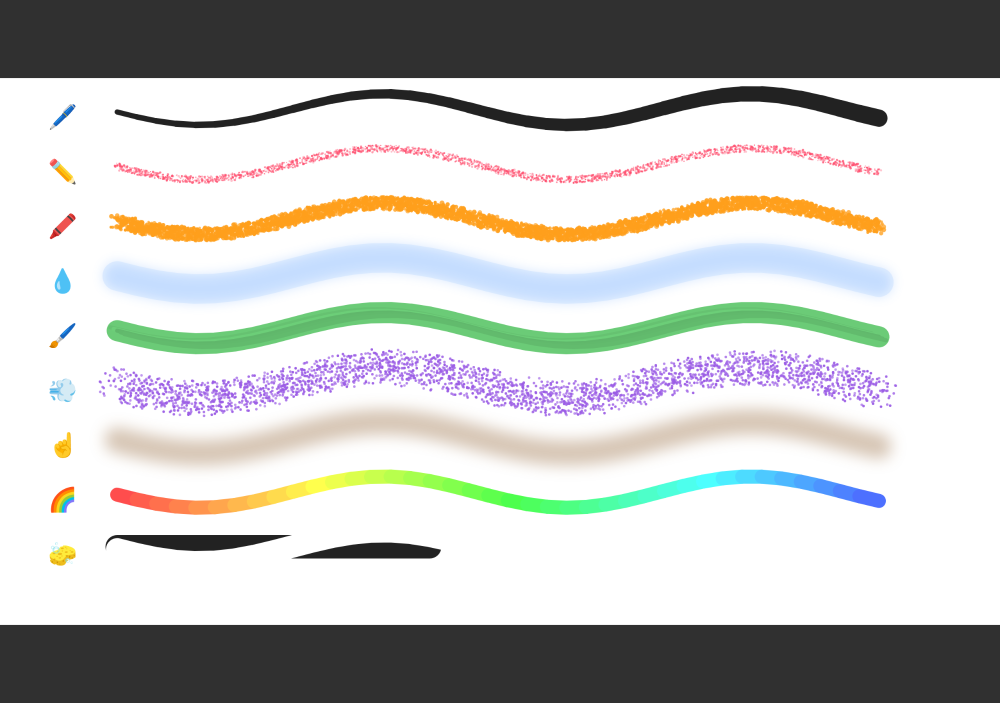

- 上 の ボタン は えもじ ＋ ことば（もどす・ぜんぶ けす・あたらしい かみ・さくひん・しゃしん に かく・まほう・ペン だけ・いんさつ・しゃしん に いれる・ホーム に はる）
- 🖼️ さくひん：いままで の 絵 を 大きな カード で ならべる（日づけ つき）。おすと ひらく、ながおし で ホーム に はる・けす
- スタンプ：↺ ↻ で 30 ど ずつ かたむける、🎲 で おす たび ばらばら。ペン で おすと つよさ で 大きさ が かわる（ふるい 絵 も そのまま ひらける）
## へや の ホーム

ホームは「その子の へや」。部屋に おくのは 大きな 6 つだけで、押すと 小さな まど で なかみ を えらびます（おやメニュー →「🏠 ホーム」で タブ式にも もどせます）。

| もの | なかみ |
| --- | --- |
| 📋 けいじばん | とけい・てんき／カレンダー（今週と よてい）／じかんわり を 10 びょう ごとに スライド（◀ ▶・スワイプでも） |
| 🪟 まど | 時間と てんき で そら が かわる |
| 📚 ほんだな | 1 だん ＝ おはなし／さんすう（くく・たしざん・くるくる）／こくご（もじ・タイピング・わーぷろ）／しらべる（ちず） |
| 🧸 おもちゃばこ | ショーウインドウ：あそぶ（おえかき・がっき・パズル）・アプリ・仕分けた カテゴリー |
| 📺 テレビ・📻 ラジオ | どうが（ロック中は 🔒 と のこり時間）・おんがく |
| 📞 でんわ | でんわ ボタン |

上の 見出し（とけい・子どもの きりかえ・⚙️ 2 びょう ながおし）と、右はしの ジャンルごとの タブ（とけい・仕分けた カテゴリー・どうがサービス・ウィジェット）は タブ式と おなじ。へや は「🏠 ホーム」タブの なかみ です。中身が ない だん・もの は おきません。「よるは へやを くらくする」は おやメニューで オンに できます（はじめは オフ）。

| ほんだな | おもちゃばこ |
| --- | --- |
| 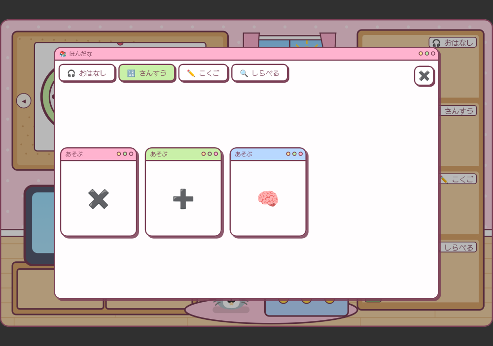 | 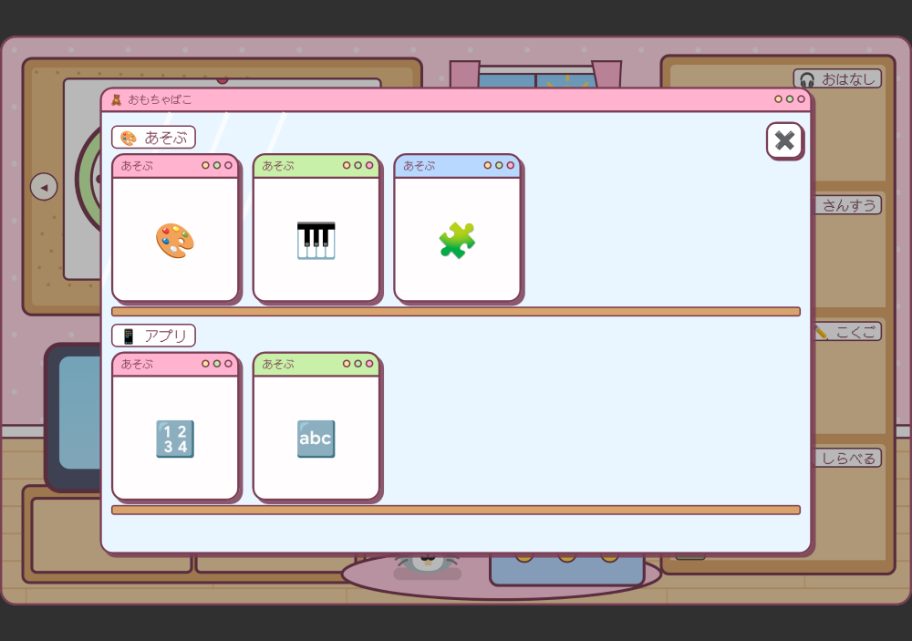 |

## じしょ・ひゃっかじてん

本棚の「しらべる」→「📖 じしょ」。家の CD-ROM 辞書を 変換した データ（SQLite 1 ファイル）を よみます。データ と 変換スクリプト は 非公開リポジトリ（`dict/README.md`）。
- タブ：あ こくご（デイリーコンサイス）・A えいご・🌍 ひゃっか（エンカルタ）、「🔎 もっと くわしく」で 広辞苑・研究社
- 読み・漢字・英語 で ひく。漢字 は 学年（小1〜6・中学）つき、その子の 学年 まで の「きょう の かんじ」
- リンク で とぶ・⬅️ で もどる・🔊 読みあげ、図・筆順・外字 も 表示
- 辞書 は あとから 足せる：dict フォルダ の `*.sqlite` を ぜんぶ 読む（1 冊 ずつ でも まとめて でも）。SD カード の `Android/data/com.theta.kidshome/files/dict/` に おける
- おやメニュー「📖 じしょ・ひゃっかじてん」：ファイル ごと の 一覧・けす・さがしなおす、ファイル を えらんで 入れる（SD が あれば SD に）、見せる 辞書（はじめ は 医学辞典 も ぜんぶ）

## ガイド役（3D キャラ・きせかえ）

へや の マスコット を 3D キャラ に できます（いき・まばたき、タップで 手をふる・えがお・ジャンプ）。👗 で きせかえ（子どもごと）。

3D は タブレット では かきません。パソコン（または Actions）で 3D を **パラパラ漫画（連番の 絵）** に して おき、アプリ は 絵 を ならべる だけ です（どの 端末 でも 出て、電池 も くわない）。
服・かみ の 色ちがい は、色 を かける ところ の マスク も 作って おいて、アプリ が ぬります。
- 3D → 絵：`guide-renderer/`（[three.js](https://threejs.org/)・[three-vrm](https://github.com/pixiv/three-vrm)、MIT）。`node guide-renderer/render_sprites.js <パック> <出力>`（Node と Playwright）
- アプリ には デフォルト の「ガイドちゃん」（pixiv の VRM サンプル、VRM Public License 1.0：再配布・改変 可、クレジット不要）の 絵 が 入っています（約 1MB）
- 自分の モデル は **非公開リポジトリ の Release（`guide-pack.zip`）** を 読み取り専用トークン で とってくる か、zip を 読みこむ（おやメニュー →「🧸 ガイド役」）。パック の 作りかた は 非公開リポジトリ の README

## がっき

| ふつう | 🎓 れんしゅう |
| --- | --- |
| 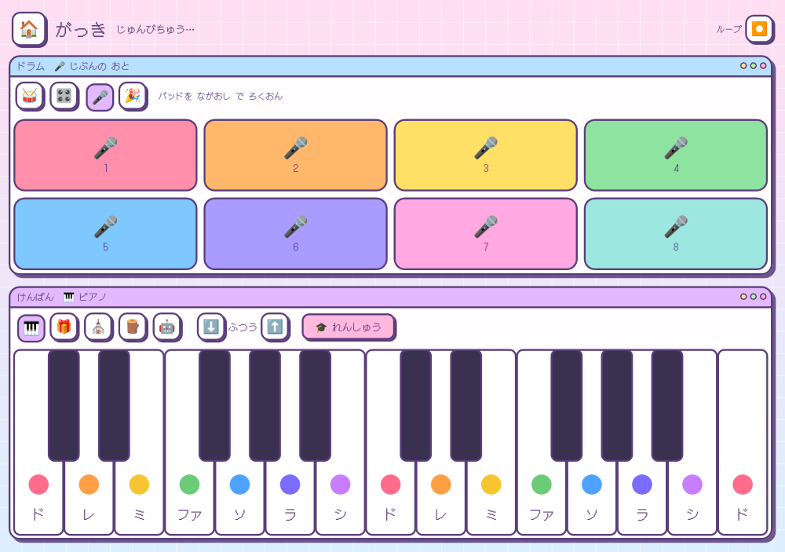 | 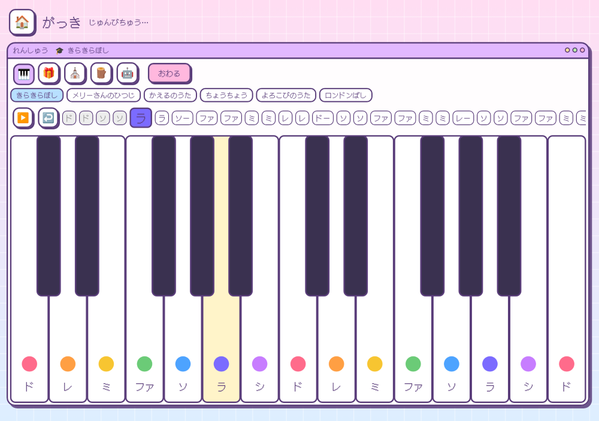 |

上に ドラムパッド、手前（下）に けんばん。

- **🎤 じぶんの おと（サンプラー）**：ドラムのセットで 🎤 を選び、パッドを **ながおし** している間マイクで録音（4 びょうまで）。そのパッドを押すと、録った音が鳴ります。最初の無音は切り、音の大きさをそろえます
- **🎹 曲を ひいて きろく**：おやメニュー「🎹 ピアノの れんしゅう曲」→「けんばん で ひいて きろく」。おうちのひと が ひくと、テンポ（メトロノーム）に あわせて ひくと、押した長さ・休みを 8分音符 まで 読みとって ドレミ書き に して 入れます。あとで 文字 で なおせます
- **ドラム**：パッド 3 れつ（はじめ は 🥁 ドラム・🌏 せかい・🎉 たのしい、各 12 こ）。れつ の 左 の アイコン で 🎛 でんし・🎤 じぶん の おと にも かえられる。🎤 は パッド を ながおし → 赤い おび が 出たら こえ を だす → はなすと おわり（4 びょう まで、とれたら すぐ きかせる）
- **🔁 ループ**：はやさ（BPM、はじめは 96）・はく（2/3/4/6）・しょうせつ（1/2/4/8）を きめて、その ながさ を くりかえす。
  - ⏺ で 1 しょうせつ カウント（3・2・1）してから ろくおん、もう一度 ⏺ で おわり（くりかえしは つづく）。もう一度 ⏺ で かさねどり
  - タイムライン（16 ぶん の マス）に ドラム と けんばん が 見える。ドラム は マス を タップ しても おける・けせる
  - 🔔 メトロノーム、🧲 マスに ぴったり、↩️ さいごに 録った ぶん を けす、🗑️ ぜんぶ けす
  - 音色に 🎶 マリンバ を たした。うちがっき は 大きめ に

**れんしゅう**：曲を選ぶと、次に押す けん が光って、押すまで待ってくれます（片手・1 音ずつ）。上にドレミのならびが出て、いまの音が大きくなります。▶️ でおてほん。
入っている曲は、著作権の切れた童謡・名曲（きらきらぼし・メリーさんのひつじ・かえるのうた・ちょうちょう・よろこびのうた・ロンドンばし）。
せってい →「🎹 ピアノの れんしゅう曲」で、ドレミ書き（例 `ドドソソララソー`、＋で高い音、♯で半音、ーでのばす、`_` で半分＝8分音符、`・` で付点、`ん` で休み）で曲を足せます。
著作権のある曲（ミッキーマウス・マーチなど）は同梱していません。家で使う分は、ここから足してください。

## くるくる思考パッド（内蔵）

くるくる思考パッド（回転盤・回転図形・かさねる・積み木 3D・ホワイトボード ほか）を、そのままアプリの中に入れました（`app/src/main/assets/edupad`）。オフラインで動き、ホームの「🧠 くるくる思考パッド」から開きます。
📷 ほぞん・PNG は「写真」へ、バックアップの書き出しは「ダウンロード」へ保存、共有は Android の共有シート、🖨️ は Android の印刷につながります。左下の 🏠 でホームへ。
くるくる思考パッドを更新したときは、`app/` フォルダを `assets/edupad` に置き換えます（`index.html` の 2 か所の印 `kidshome-bridge.js`／`!window.KidsHome` は残す）。

## スタンプ・シール ライブラリ

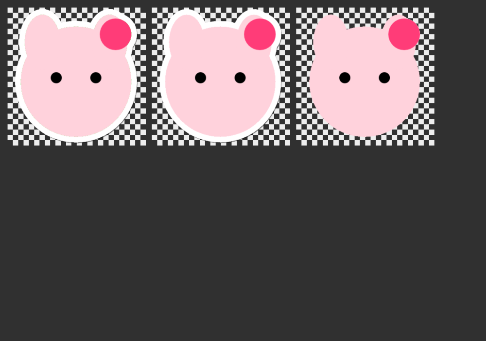

写真や画像から シール を作って、ライブラリにためておきます（おえかき のスタンプ、ホームに うかぶ シール などで使う）。

- 作り方：おえかき の 🌟 →「➕」、または おうちのひと →「🌟 スタンプ・シール ライブラリ」→「＋ シールを つくる」
  1. 📷 写真・画像を選ぶ（持っているシールを撮った写真など）
  2. **✨ かたどり**（Gemini が主役だけを切り抜く。写真は Google に送られます）／ **✂️ まわりを けす**（白い紙などの背景の色を消す）／ **⬜ そのまま**
  3. 🤍 白いフチ（シールの形）あり・なし、なまえ を付けて ライブラリへ
- おえかき：スタンプの列に ライブラリのシールが並ぶ（大きさは 3 だん）。🏠 で そのシールを ホームに うかべる
- ホーム：うかべた シールは ふわふわ動き、指で動かせる。タップで大きく・はがす
- 書き出し・読み込み：ZIP（index.json と PNG）。ほかの端末・ほかの機能でも同じ形で使えます
- 市販のシールの写真から作ったものは、家の中だけで使ってください（ZIP を人に配らない）

## もじ れんしゅう（手書きフォントの素材あつめ）

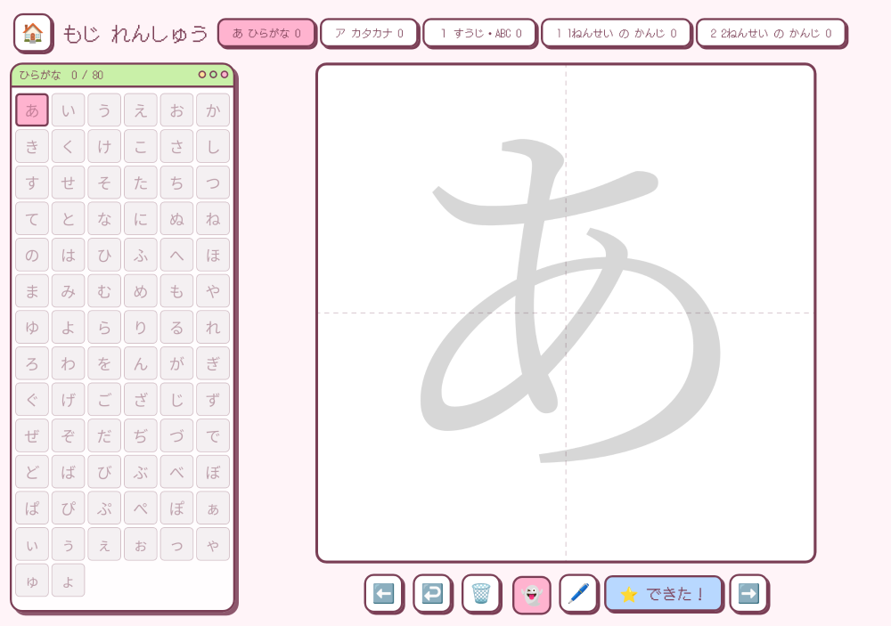

- ひらがな・カタカナ・すうじ と、**学年別漢字配当表（2020 年度からの 1026 字）** を 1 ねんせい〜6 ねんせい の メニュー で（80・160・200・202・193・191 字）。その子の学年 より 上 は「これから」と 出ます。学年は「こどもごとの設定」で選び、4 月に自動で 1 つ上がります
- 書いた字は その子の字で一覧に並び、まだの字に自動で進みます
- 書き出し：おうちのひと →「✍️ 手書きフォントの素材」
  - **おれん字 PDF**：おれん字 てがき と同じ用紙（A4 横・20×10 マス・※とメモ枠）に、書いた字をそのマスへ。書いた字のあるシートだけ
  - **ZIP**：PNG（512px 透過）・SVG・線のデータ（strokes.json、おれん字 てがき と同じ形式）
- 都道府県名の 11 字（茨・媛・岡・熊・埼・鹿・栃・奈・梨・阪・阜）は おれん字 の用紙に無いので、PDF には出ず ZIP にだけ入ります
- 漢字の学年は [learned-kanji](https://www.npmjs.com/package/learned-kanji)（MIT、学年別漢字配当表 平成29年告示）から、用紙の文字の並びは おれん字 てがき から

## くくの ひょう

9×9 のます。

- 「〇のだん」を押すと その段を、うえの すうじ を押すと たての ならびを、順に読み上げます（読んでいる ます が光る）。
- ます を押すと「さざんが く」と読み上げ、右に 式・となえかた・まるの図（3 が 4 こぶん）を大きく出します。
- 🙈 かくす：答えが ★ にかくれ、押すと ひらきます。🎲 もんだい で まだ ひらいていない ます を出題（「さざんが…」まで読む）。もう一度 🙈 で ぜんぶ かくしなおし。
- 🐢 で ゆっくり読み上げ。読み上げは端末の「音声読み上げ」（日本語）を使います。

## たしざん の ひょう

くくの ひょう と おなじ 形（読み上げなし）。「1〜9」と おうようの「11〜20」（11〜20 に 1〜9 を たす）。
🙈 かくす・🎲 もんだい も おなじ。右に 10 の わく（ピンク＝たされる数、みずいろ＝たす数）と「10 と 3 で 13」。

## ちず

おうち・がっこう・あそびに いく ところ を ピンで出して、ちりの かんかく を そだてます。

- 地図は 国土地理院（🗾 ちず／🌫️ うすい）と OpenStreetMap（🌍 OSM）を切り替え。🏡 おうちへ・📍 いまここ（おおよその位置）・🗾 日本ぜんたい。
- ばしょを押すと「おうちから まっすぐ ○キロ」。みちを調べてあれば「みちのり ○キロ・くるまで ○ふん」と、🚗 いきかた で 道を なぞるように かきます。
- ✏️（おうちのひと かくにん）で へんしゅう：地図を ながおし か 🔍 さがす で ばしょを ふやす（えもじ・メモ・「ここが おうち」）、ピンを押して なおす・🚗 おうちからの みちを しらべる。
- 🛣️ せん：高速道路・線路・川 を なまえで さがして、色つきの線と なまえ札で かさねます（例：東名高速道路、東海道新幹線、多摩川）。右の「せん」で 見せる・かくす。
- データ：検索 Nominatim、みち OSRM（routing.openstreetmap.de）、線 Overpass（どれも © OpenStreetMap contributors）、地図 地理院タイル。データはタブレットの中（map.json）に保存。

## じかんわり

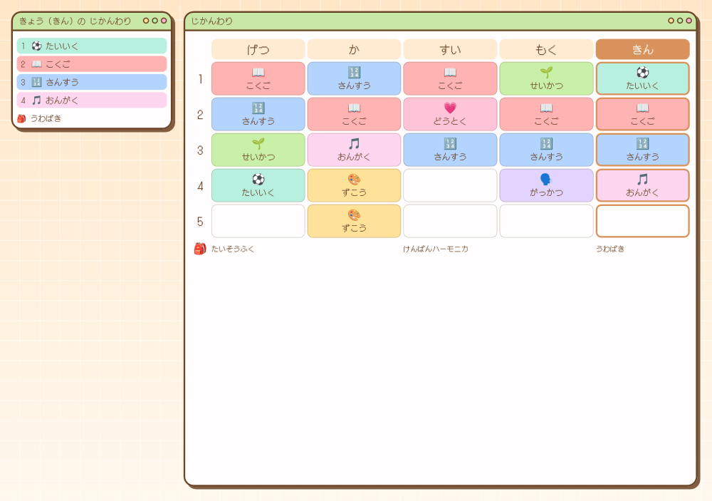

せってい →「こどもごとの設定」で、ようびごとに 1〜6 じかんめ と もちもの を入れます（スプレッドシートの「じかんわり」表からも）。
ホームに「きょう（15 時からは あした）の じかんわり」ともちもの、右はしに「📒 じかんわり」のタブ（1 しゅうかんの表、きょうの列が光る）が出ます。

## Hatch シリーズ

せってい →「🥚 Hatch シリーズのアプリ」から、おえかきハッチ（Theta.Oekaki.Hatch）を GitHub Releases から入れる・更新する・ひらく ことができます（取得 → SHA-256 照合 → インストール画面）。

## カレンダー（Google カレンダー）

ホームのカレンダー（つき／しゅう）に予定を出す方法は 2 つ。せってい →「📼 端末の動画・音楽・おはなし」のカレンダーのところ。

- **Google カレンダーの iCal アドレス（おすすめ）**：パソコンの Google カレンダー → 設定 → 見せたいカレンダー →「iCal 形式の非公開アドレス」を貼る。子どものタブレットに Google アカウントを入れずに、家族のカレンダーを読むだけで出せます（いくつでも、スプレッドシートの「せってい」に `カレンダー｜URL` でも）。くりかえしの予定にも対応
- **この端末のカレンダー**：タブレットに入っている Google アカウントのカレンダー（許可が必要）

## Android TV

Android TV（Google TV）にも入れられます。TV のアプリ一覧に横長のアイコンで出て、ホームアプリにもできます。
リモコンの十字キーで ボタン・タブ を選べます（選んでいるものは太い枠）。おうちのひとメニューは ⚙️ を選んで **決定ボタンを 2 秒ながおし** → かけ算。
おえかき・がっき・くるくる思考パッド はタッチが前提なので、TV では動画・音楽・おはなし・アプリの起動が中心になります。

## 端末の動画・音楽・おはなし

| ビデオ | おんがく・おはなし |
| --- | --- |
| 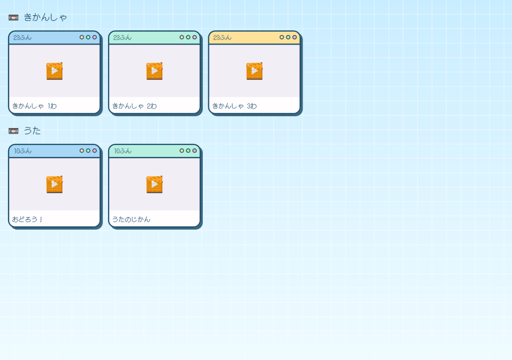 | 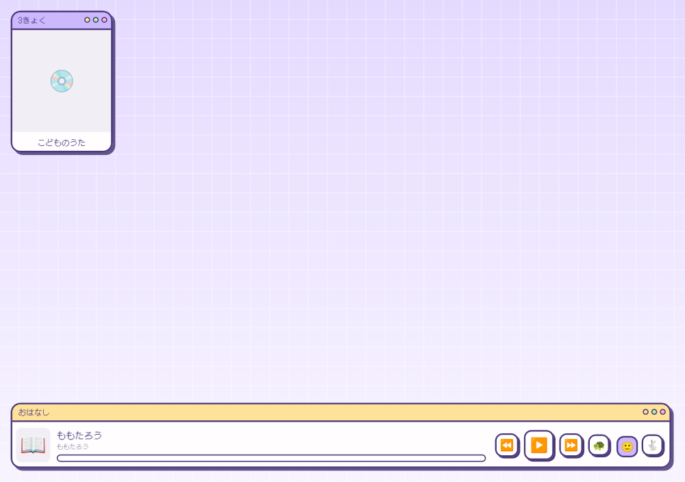 |

せってい →「📼 端末の動画・音楽・おはなし」で、動画と音楽へのアクセスを許可します。

- **ビデオ**：フォルダごとの「たな」に、動画のコマをサムネイルで並べます。押すとホームの中で再生し、同じたなの動画を続けて再生します。前に見たところから続きを再生し、見たところまでを赤い線で表示します。どうがロックの対象で、ロックが始まると止まってホームに戻ります。
- **おんがく**：アルバムごと（ジャケットつき）。ほかのアプリに行っても鳴り続け、通知や車のボタンでも操作できます。
- **おはなし（オーディオブック）**：`.m4b`、または「Audiobooks」「オーディオブック」「おはなし」というフォルダの音声。続きから再生し、30 秒もどす／すすむ、速さ（🐢・🙂・🐇）を変えられます。
- カメラで撮った動画などは、フォルダごとに「かくす」にできます（Camera・Screenshots などは初めからかくしています）。
- 再生は Google の Media3（ExoPlayer）。再生できない形式は、VLC が入っていれば「VLC で みる」が出ます。

## アプリの仕分け（見せる・かくす）

せってい →「🗂 アプリの仕分け」の「仕分けガイド」、または「すべてのアプリ」の「仕分け N」（N は未分類の数）。

1. **カテゴリーを用意**：べんきょう・あそび・どうが・おんがく・えほん・つくる・しゃしん・おうちのひと（見せない）から選ぶ。自分で作ることもできる
2. **1 つずつ振り分け**：アプリが大きく出るので、入れるカテゴリーか「🙈 かくす」を押すと次へ。おすすめは枠が太い。「もどす」「あとで」「ここで終わる」

カテゴリーごとに **どの子に見せるか** と **どうが扱い（ロック対象）** を選べます。見せるカテゴリーは、その子のホームの右はしにタブで出ます。
**未分類と「かくす」のアプリは、どの子にも出ません**（新しく入れたアプリも、仕分けるまでは出ません）。

## 親のスマホから設定（Google スプレッドシート）

タブレットにログインは要りません。親のシートを「リンクを知っている全員（閲覧者）」で共有し、そのリンクをタブレットに貼るだけです。

1. せってい →「📝 親のスマホから設定」→「いまの設定を書き出す」→ Google ドライブに保存
2. ドライブで開いて「Google スプレッドシートとして保存」
3. 共有 →「リンクを知っている全員」（閲覧者）→ リンクをコピーして、タブレットに貼る

以後はスマホでシートを書き換えると、タブレットが 15 分ごと（とホームに戻ったとき）に読み込みます。電波が無いときは前の内容のまま。

| シート | 1 行目 | 書き方 |
| --- | --- | --- |
| こども | なまえ・テーマ | テーマは うさぎ／ねこ／くま／きょうりゅう／ユニコーン／うみ／おほしさま |
| ボタン | こども・しゅるい・なまえ・URL・アプリ・えもじ・どうが | こども は名前か「ぜんいん」。しゅるい は どうが／アプリ／おえかき／がっき／くるくる／でんわ／わーぷろ／パズル／タイピング／もじ／くく／たしざん／ちず。アプリはパッケージ名かアプリ名 |
| カテゴリー | なまえ・えもじ・みせる・どうが | みせる は「ぜんいん」「おねえちゃん, いもうと」、空なら見せない。どうが に ○ でロック対象 |
| アプリ | アプリ名・パッケージ・カテゴリー | カテゴリー名か「かくす」。空なら未分類（出さない） |
| じかんわり | こども・ようび・1〜6・もちもの | ようび は げつ／か／すい／もく／きん／ど（「月」「水曜」でも可） |
| せってい | こうもく・あたい | かけ算＝ふつう／むずかしい、てんき＝地名／いまいるところ／なし |

ウィジェット・おんがくアプリ・呼びかけ・どうがロックはタブレットだけの設定です（どうがロックは呼びかけの `/lock 30` が便利）。呼びかけのページのアドレスはシートに入れません。

## おうちのひとからの呼びかけ

1. せってい →「📣 おうちのひとからの呼びかけ」をオン
2. 「他のアプリの上に重ねて表示」を許可（動画を見ている最中でも前に出すため）
3. 「このリンクを自分のスマホへ送る」で、送るページ（`https://ntfy.sh/kidshome-…`）を自分のスマホへ
4. そのページで文字を送る：
   - `そろそろ おわりだよ` … 呼びかけだけ
   - `/lock 30 ごはんだよ` … どうがを30分ロックして呼びかけ
   - `/unlock` … ロック解除

中継には公開サービス ntfy.sh を使います（アカウント不要）。ページのアドレスを知っている人は誰でも送れるので、人に教えないでください。
タブレットには「呼びかけを待っています」という通知が出たままになります（常駐のため）。

## 💾 SD カード に コンテンツ を 入れる

動画・音楽・おはなし・辞書 の フォルダ構成 は [docs/SD_LAYOUT.md](docs/SD_LAYOUT.md)。ビデオ・おんがく・おはなし は 左 に シリーズ（フォルダ）、右 に サムネイル の 2 ペイン で 出ます。
（予定：Wi-Fi の とき Tailscale 経由 で NAS と 同期）

## 👆 タッチ で あそぼ

おもちゃばこ の「あそぶ」に。さわる と うごく・なる・しゃべる 小さな あそび（絵 は ぜんぶ プログラム で 描いた オリジナル の ベクター、にっこり かお と ほっぺ）。
ぷちぷち（わらう たま を わる）・くだもの の き（りんご・みかん・ぶどう が おちる、みき で もどる）・でんわ（ピッポッパ と かず の 読みあげ）・めだまやき・もぐもぐ（たべもの を あーん）・たんぽぽ（わたげ が とぶ）・はなび・のりもの（パトカー・しょうぼうしゃ・きゅうきゅうしゃ・バス・くるま）・トースター・どうぶつ（なきごえ）・かず（1〜10）。「えらぶ」で 一覧、「ちぇんじ」で つぎ。

## 👗 きせかえ ドール（ごほうび）

家 で 買った ドール素材 を、非公開リポジトリ の Release（`doll-pack.zip`）から ガイド役 と おなじ トークン で とってきて、へや の ガイド役 に（素材 は 公開 リポジトリ・APK に 入れない）。
- へや の 👗 で きせかえ：からだ（はだ の いろ）と かお、それぞれ の しゅるい の さいしょ の 3 こ（おや が 0／3／5／10 に）は はじめ から、のこり は 🔒。はじめ に 🎟 3 まい
- 🎟 きせかえ チケット：もじ れんしゅう で 5 もじ かくと 1 まい（おや が 3／5／10 に、🎟 ＋1 おまけ も）。🔒 を えらんで あける
- 🎲 でたらめ コーデ、⭐ ガイド の オン／オフ。ぶき・したぎ は はじめ かくす（おや が かえる）
- おやメニュー「👗 きせかえ ドール」：📥 とってくる・zip から・ぜんぶ あける

## 🤖 うごかして ゴール（プログラミング）

おもちゃばこ の「あそぶ」に。カード を ならべて ▶、ロボット が その とおり に うごいて 💎 を めざす（小学校 の「プログラミング的思考」）。
- 1〜6：じゅんばん（↑↓←→）／7〜12：🔁 くりかえし（中 に カード、2〜12 かい）／13〜16：⏩ かべ まで／17〜20：❓ もし かべ なら（すすむ むき と まがる むき）
- ぶつかったら その カード が 赤 く なる → なおして もう いちど（デバッグ）。すくない カード で ⭐⭐⭐
- ステージ は `assets/content/coding.json`（ぜんぶ とける こと を テスト で たしかめ）

## 🛒 おみせやさん（レジ）

おもちゃばこ の「あそぶ」に。やおや・パンや・おかしや・ぶんぼうぐや（しょうひん と ねだん は `assets/content/shop.json`）。
- 🧒 おきゃくさん：しょうひん を おして かごへ →「ごうけい」→ おさいふ の お金 を トレー に だして「はらう」。たりない・ぴったり・おつり（だしかた も）を 読みあげ
- 🧑‍🍳 おみせのひと：おきゃくさん が 来て 1000 円 など で はらう → レジ の お金 から おつり を トレー に だして「わたす」。💡 で 計算 の ヒント
- レベル：ぴったり（10 円 きざみ・100 円 まで）／おつり（1 円 まで）／ぜいこみ（消費税 10%、小計・税・合計）
- 👭 ふたりで：タブレット を つくえ に おいて よこ から むかいあう。ひだり 半分 が おきゃくさん、みぎ 半分 が てんいんさん（それぞれ の 向き に 回して ある。↕ で うえ／した わけ にも できる）
  1. おきゃくさん が しょうひん を えらんで「レジ へ」→ 2. てんいんさん が 1 こ ずつ おして ピッ（🛍 ふくろ に 入る）→「ごうけい」
  3. おきゃくさん が おさいふ から お金 を だして「はらう」→ 4. てんいんさん が おあずかり を 見て おつり を だして「わたす」→ 5. おきゃくさん に おつり と ふくろ
- 硬貨・お札 は 本物 に にせた 色（5 円・50 円 は あな あき）。できたら ⭐
- 🏷 バーコード モード（ほんもの の おもちゃ で、おうち で あそぶ とき）：いままで の 絵 を おす モード は そのまま。おもちゃ の たべもの に 貼った QR ラベル を、インカメラ に かざす と しょうひん と ねだん が 入る（「にんじん、80 えん」と 読みあげ）。外 では いままで の モード で
  - 👭 ふたりで でも、てんいんさん の「🏷 バーコード」で おなじ（おきゃくさん は おもちゃ を わたす）
  - インカメラ の ある 辺（よこ に した とき の 上 まんなか）に 小さな まど と「↑ カメラ に QR を かざして ピッ！」が 光る。さかさま に おく と 下 に 出る（親モード で うえ／した 固定 も できる）
  - 外付け の バーコードリーダー（USB／Bluetooth の キーボード として うつ もの）でも 読める。QR が 読める 2 次元 リーダー が いる
  - ほんとう の ねだん に ちかい ので、もの の ねだん を おぼえる れんしゅう にも なる

### 🏷 QR ラベル を つくる（親モード）

親モード の「🏷 おみせ の しょうひん ラベル（QR）」→「🏷 ラベル を つくる」。
1. おもちゃ を カメラ で とる → Gemini が なまえ と だいたい の ねだん（1 円 の くらい は きりあげ、10 円 きざみ）と おみせ を つける
2. ちがえば なおして（±10・+100）「✅ OK（つぎ を とる）」→ 保存・印刷 して すぐ つぎ の カメラ。おす の は ほぼ OK だけ で どんどん つくれる
3. 印刷：テプラ PRO SR5900P（Wi-Fi、おなじ ネットワーク）を「さがす」で えらぶ。テプラ なし の 版 では ラベル 画像 を 共有（📤）、ぜんぶ を 1 まい に まとめた シート も だせる
- QR の 中身 は `KH1.<ねだん>.<おみせ>.<なまえ の 16 進>`（英数字 だけ なので キーボード 式 リーダー でも うてる）
- ラベル と 写真 は タブレット の 中 だけ（filesDir/shop_items.json）

#### テプラ 印刷 を 有効 に する（いちど だけ）
TEPRA-Print SDK は キングジム の 使用許諾 が いる ので、公開 リポジトリ には 入れて いません。
1. 非公開 リポジトリ `Theta.Kidshome.Hatch.Closed` に `tepra-sdk/TepraPrint.jar` と `tepra-sdk/<abi>/libTepraPrint.so`（arm64-v8a・armeabi-v7a・x86・x86_64）を 置く（「声でテプラ」で つかった SDK v1.4.0）
2. この リポジトリ の Settings → Secrets → Actions に `TEPRA_SDK_TOKEN`（非公開 リポジトリ を 読める だけ の トークン）を 入れる
3. つぎ の Release から テプラ 印刷 つき に なる（ない とき は 画像 共有 だけ）。Powered by KING JIM TEPRA-Print SDK

## 📸 プリクラ

おもちゃばこ の「あそぶ」に。
1. インカメラ で「とる！」→ 3・2・1・はい チーズ（1 まい か 4 まい れんぞく）
   - 🎤 こえ でも：「はい チーズ！」と いう と すぐ シャッター（4 まい の とき は のこり 3 まい を 3・2・1 で）。マイク を ゆるす と つかえる（Android の 音声認識。きいて いる あいだ ピコッ と 音 が する 機種 も あり）
2. らくがき：フレーム（しろ・ハート・ほし・リボン・にじ と 色）、✨ きらきら（すこし あかるく あざやか）、📅 ひづけ、🖊 ネオン ペン、🌟 スタンプ（じぶん の スタンプ・絵文字、おおきさ ±）、↩️ もどす
3. できた！：🖨 instax（instax mini Link の アプリ へ わたす → アプリ で プリンター を えらんで いんさつ）／💾 ほぞん（しゃしん の KidsHome）／🖨 いんさつ（ふつう の プリンター）
- でき あがり は 1200×1600（よこ 3：たて 4、instax mini の 形）。instax の アプリ が 入って いない とき は ふつう の「きょうゆう」

## 🎲 すごろく

おもちゃばこ の「あそぶ」に。30 マス の へび みち を、サイコロ を おして すすむ。
- 1〜4 人。🧒 ひと か 🤖 コンピューター を えらべる（ひとり でも あそべる）
- コマ は じぶん の スタンプ（こうかん した もの・かいた 絵）か どうぶつ の 絵文字
- マス：❓ もんだい（こたえる と 2 すすむ。10 まで の たしざん／20 まで の たしざん・ひきざん／くく）、⏩ 2 すすむ、🔙 2 もどる、💤 1 かい やすみ、⭐ キラキラ（🪙 1）
- ゴール で 🪙 5（30 ぷん に 1 かい まで）、もんだい の せいかい で 🪙 1

## 🧸 ゆるキャラ（にほん パズル）

けん を はめる と 出る カード に、その けん の ゆるキャラ の しょうかい（なまえ・どこ の キャラ か・なまえ や かたち の ゆらい）が 出る。みだし の「🧸」で ずかん。
- 47 都道府県 ぜんぶ（`assets/content/yuruchara.json`。足す とき は この ファイル に）
- 公式 の 絵 は 著作権 が ある ので 入れて いない（モチーフ の 絵文字 だけ）。ほんもの は おうちのひと と しらべて みてね

## 🔧 おうちのひと（親モード）の 整理

「⚙️ せってい」は ひだり の なかま わけ から えらぶ：
- 👧 こども・ホーム（この タブレット・こども ごと・カテゴリー・ウィジェット・てんき）
- ⏰ せいげん・あんしん（どうが の じかん・おうちのひと かくにん・レスキュー）
- 🪙 ごほうび・あそび（ポイント・暗証番号・きせかえ・ガイド・スタンプ・レジ の ラベル）
- 🎬 どうが・おんがく・じしょ
- 🔗 つなぐ・うつす（📦 せってい を まとめて・QR・スプレッドシート・チャット・おや の スマホ）
- 🔧 キー・アップデート（Gemini・アップデート・Hatch）

### 🎹 ピアノ の 曲 を そろえる
- 「💌 かぞく の チャット」の あいことば が おなじ タブレット どうし は、足した・けした 曲 が じどう で とどく（曲 ごと に あたらしい ほう を のこす。両方 で 足した 曲 は どちら も のこる）。「🔄 いま そろえる」も
- スプレッドシート に「きょく」シート（なまえ・ドレミ）を つくる と、その とおり に なる（書きだし にも 入る）

### 📦 せってい を まとめて うつす
「🔗 つなぐ・うつす」→「📦 せってい を まとめて 書きだす・うつす」
- 💾 ファイル に 書きだす／📂 ファイル から 読みこむ（kidshome-settings.json）
- 🔁 QR で ほか の タブレット へ：なんまい か の QR を じゅんばん に 出す → うけとる がわ は「📷 QR を 読みこむ」で インカメラ に むける だけ（ぜんぶ そろう と 入る）
- 入る もの：こども・タイル・カテゴリー・せいげん・ポイント の きまり・暗証番号・チャット の あいことば・テプラ・きせかえ の せってい など
- 入らない もの：ポイント の 残高・りれき、GitHub トークン、この タブレット が だれ の もの か・ふせん（Gemini キー は スイッチ で えらぶ）

## 🪙 ポイント・ごほうび しへい・💌 チャット

### 🪙 ポイント
ホーム の みだし の「🪙 123」で つうちょう（のこり・きょう もらった 数・りれき・🎁 こうかん）。
- もらえる：もじ 1 字 = 1（1 セット ぜんぶ で +10）、くく・たしざん・そろばん・とけい の せいかい = 1、おみせやさん の おつり せいかい = 1、うごかして ゴール = ⭐ の 数、にほん パズル = 5（ぜんぶ 20）、パズル = 3、タイピング = 3
- おなじ 字・おなじ もんだい は 1 日 1 かい だけ。1 日 の 上限（30／50／100／なし）は 親モード で
- つかう：きせかえ 1 こ = 10、ごほうび スタンプ = 親 が きめた ねだん（10／20／50）
- まえ の 🎟 チケット は のこって いた 数 × 10 ポイント に かわります（はじめ に +30）
- つうちょう・きせかえ・こうかん の 画面 に「いま 🪙 ○」と「✏️ 字 を かいて ためる」「➕ たしざん」「✖️ くく」ボタン（たりない とき も）

### 💴 ごほうび しへい（QR）
親モード「🪙 ポイント・ごほうび しへい」で 1／5／10／50／100 ポイント の しへい を A4 に 印刷（または 共有）。
子ども は「🪙」→「📷 ごほうび しへい を よみこむ」で インカメラ に かざす →「🔑 おうちのひと」で **暗証番号**（4〜8 けた、親モード で きめる）→ もらえる。
- 1 まい 1 かい（つかった ばんごう は タブレット が おぼえる）。暗証番号 が ない あいだ は むずかしい かけ算
- 親モード の 入り口 も 暗証番号 に できる（スイッチ）

### 🧩 スタンプ を きりわける・🎁 ごほうび スタンプ
親モード「🌟 スタンプ・シール ライブラリ」→「🧩 1 まい の 絵 を きりわける」：イラスト が たくさん ならんだ 画像（白 など 1 色 の 背景）を えらぶと、1 こ ずつ に きって 背景 を けし、しろい ふち を つけます。えらんで「ライブラリ へ」。
- 「ふつう」は すぐ つかえる。「🎁 🪙20」など に する と、子ども が ポイント で こうかん する まで つかえない（ライブラリ の 下 の ボタン で かえられる）
- こうかん した スタンプ は おえかき・ホーム に うかべる・チャット で つかえる
- 🖍 ぬりえ：おえかき の「🖍 ぬりえ」で えらぶ（りんご・さかな・おうち・ねこ・おはな・くるま・ちょうちょ・ロケット・アイス・くま。アプリ で 線 を ひいた もの）。線 は いちばん うえ に かさなる ので、ぬって も きえない。🪣 バケツ で かこまれた ところ を 1 かい で ぬれる
  - 「➕ がぞう から つくる」：ぬりえ の 画像 や 線画 を えらぶ と、黒 い 線 だけ に して 足せる（ながおし で けす）
  - あとで 素材 を 足す とき は `app/src/main/assets/nurie/` に PNG（黒 い 線・白 か すけた 背景）を 入れる と 内蔵 の あと に ならぶ
- 🎨 おえかき：「✏️ ペン だけ」は ながおし で きりかえ（うっかり かわらない）。ゆび で スタンプ を おす とき は ながく おす ほど 大きく（おして いる あいだ ふくらむ、みじかく はなす と 小さい）。ペン モード では 筆圧 で 大きさ
- 🎨 おえかき の 🌟（スタンプ）：じぶん の スタンプ が さいしょ に 大きく ならぶ。まだ こうかん して いない ごほうび スタンプ は 🔒 で 見えて、おす と こうかん 画面（「🎁 もっと」も）
- 🎨 おえかき の「🌟 スタンプ に する」：じぶん で かいた 絵 の まわり を けして スタンプ に（すぐ つかえる）
- 自作・フリー素材 を つかって ください（キャラクター もの は 入れない）

### 💌 かぞく の チャット（ntfy）
親モード「💌 かぞく の チャット」で「🎲 あたらしく つくる」→「きめる」。ほか の タブレット には「🔗 QR」を 見せて「📷 QR を よみこむ」（または 手 で 入力）。
- ホーム の「💌」で、スタンプ と きまった ことば（おはよう・だいすき・あそぼう！ など）を おくりあう。とどく と 上 に「💌 ○○ から」
- 中身 は あいことば から つくった かぎ で 暗号化（AES-GCM）して ntfy.sh に おくる ので、サーバー から は 読めない。とどいて 3 時間 いない に アプリ を ひらく と 受けとれる
- NAS に ntfy を 立てたら「ntfy サーバー」を その アドレス に かえる だけ

## 👪 かけいず・たんじょうび

カレンダー の「👪 かけいず」から。おうちのひと が ✏️（かくにん つき）で 家族 を 入れる：なまえ・よびかた・かお写真・たんじょうび（年 は なくても）・おとうさん／おかあさん・けっこん して いる 人・この 子 本人（⭐）。ともだち は たんじょうび だけ。
- 人 から 人 へ ゆび で ひっぱる と「わたし から みる と ゆみ は『おばさん』（わたし の おとうさん の いもうと）」「ゆみ から みる と わたし は『めい』」を 出して 読みあげ
- タップ で たんじょうび・あと なんにち・なんさい・うまれ年 の 干支
- カレンダー に 🎂、こんげつ の たんじょうび（なんさい に なるか）、けいじばん に「きょう は ○○ の たんじょうび！」
- 写真 と データ は アプリ の 中（filesDir/kin）

## 🔢 さんすう の どうぐ

- **🗾 にっぽん パズル**：都道府県 の ピース を 地図 に はめる（ぜんぶ／地方 ごと、🏷 なまえ の ヒント、ゆび 2 本 で 大きく・小さく、1 本 で うごかす、➕➖🔄）。ハマると 名前・けんちょう・名物（えもじ）・とくちょう の カード。はめた 県 を タップ でも もう いちど 見られる。カード の「📷 しゃしん を いれる」で あそび に いった ときの 写真 を 県 ごと に 入れられ、「📷 おもいで」で 行った 県 の 地図（タップ で 写真）。写真 は アプリ の 中 に 小さく して コピー（アンインストール で 消える）。地図 は Natural Earth（パブリックドメイン、`tools/build_japan_map.py`）。
- **🧮 そろばん**：玉 を タップ で はじく（上 5・下 1、定位点 つき）。🧹 ごはさん、👀 かず を かくす、🎲 おく／＋／−（1〜3 けた）。
- **🔢 ひっさん でんたく**：でんたく で 計算 すると、よこ に ひっさん（くりあがり・くりさがり・かけ算 の だん・わり算 の 商 と あまり）。👣 ひとつずつ で 1 だん ずつ 出せる。
- **もじ れんしゅう** の よこ に、おてほん の 書き順 アニメ（番号つき）・かくすう・おん／くん・ことば。タブレット に こくご 辞書 が あれば いみ も。
  データ：KanjiVG（書き順）・KANJIDIC2／JMdict（読み・ことば）、どちらも CC BY-SA（`tools/build_kanji_info.py`、`assets/licenses/kanji-data.txt`）。

## 📱 この タブレット・かべがみ

1 人 1 台 なので、ホーム には 子ども の きりかえ を 出しません。おやメニュー「📱 この タブレット」で だれ の タブレット か を えらび、「🖼 かべがみ・ロック画面 を そろえる」で テーマ の 絵（ロック画面 には なまえ）に できます。

アプリ の 仕分け では「🗑 アンインストール」も えらべます（もとから 入っている アプリ は アプリ情報 から 無効 に）。

がっき の ドラム・せかい の 音 は GM 音源（FluidR3_GM、MIT）から 書き出した 本物 の 音 です（`tools/render_gm_drums.py`）。

## 📱 おやモード（おや の スマホ から そうさ）

おや の スマホ にも おなじ APK を 入れて、タブレット と つなぎます。

1. タブレット：せってい →「📣 呼びかけ」をオン →「📱 おや の スマホ と つなぐ」で QR を出す
2. スマホ：キッズホームを開いて ⚙ →「📱 この スマホ を おやモード に」→「📷 タブレット の QR を 読んで つなぐ」
3. スマホ が タブレットごと の カード に なり、ここから：
   - めっせーじ（呼びかけ）、どうがロック（15〜120分）・かいじょ
   - 曲 を 送る（ドレミ書き または けんばん で ひいて きろく）
   - よる くらく・ガイド役・じどうアップデート・辞書のレベル
   - タブレット の ようす（バッテリー・バージョン・ロック中か・入っている曲）

つないだ とき に 合いことば（鍵）を 交換し、めいれい には しるし（HMAC）を つけるので、
呼びかけ の アドレス を 知っているだけ の 人 は 設定を かえられません（10分 より 古い めいれい も 無視）。
つなぐ QR は 自分 の スマホ に だけ 見せてください。

**🧪 ベータ テスト**：おやモード の 画面 下 の「アプリ を せいげん なし で ひらく」で、スマホ で キッズホーム を そのまま ためせます（どうがロック・夜 の くらさ・おうちのひと かくにん・辞書 の レベル・カテゴリー の 見せる 子 は はずれる）。画面 下 の むらさき の ボタン で おやモード に もどる。

タブレット は 何台 でも つなげます（子ども ごと に カード、✏️ で よびな を かえる）。2 台 いじょう つなぐ と「👨‍👩‍👧‍👧 みんな に」で メッセージ・どうがロック・曲 を まとめて 送れます。

## 制限について（大事）

このアプリは「ホームに出すものを絞る」タイプの制限です。Android の仕組み上、以下は防げません。

- 通知バーからの設定変更、最近使ったアプリ一覧からの切り替え
- 動画アプリの中で別の作品を探すこと

しっかり縛りたい場合は、あわせて次を使うのがおすすめです。

- **Google ファミリーリンク**：アプリのインストール制限・利用時間
- **Netflix のキッズプロフィール** / **Prime Video のキッズプロフィール**
- Android の **アプリ固定（画面の固定）**

## 新しい版の出し方（自動更新）

1. `app/build.gradle.kts` の `versionCode` と `versionName` を上げる
2. GitHub の Actions →「Release APK」→ Run workflow → 版（例 `v0.2.0`）を入れて実行
3. Release に `KidsHome-<版>.apk` と `SHA256SUMS.txt` が載り、タブレットが自動で見つけます

## フォント

ドット文字は [DotGothic16](https://fonts.google.com/specimen/DotGothic16)（SIL Open Font License、[licenses/](licenses/DotGothic16-OFL.txt)）。

## 開発メモ

- Kotlin + Jetpack Compose、minSdk 29 / targetSdk 35
- 設定は SharedPreferences に JSON で保存（`data/Store.kt`）
- テーマは `ui/Themes.kt` の `KidThemes` に追加するだけで増やせます
