# キッズホーム 🐰🐱

子ども用タブレット（ALLDOCUBE iPlay60 など）向けの、かわいいホーム画面アプリです。

へや の ホーム

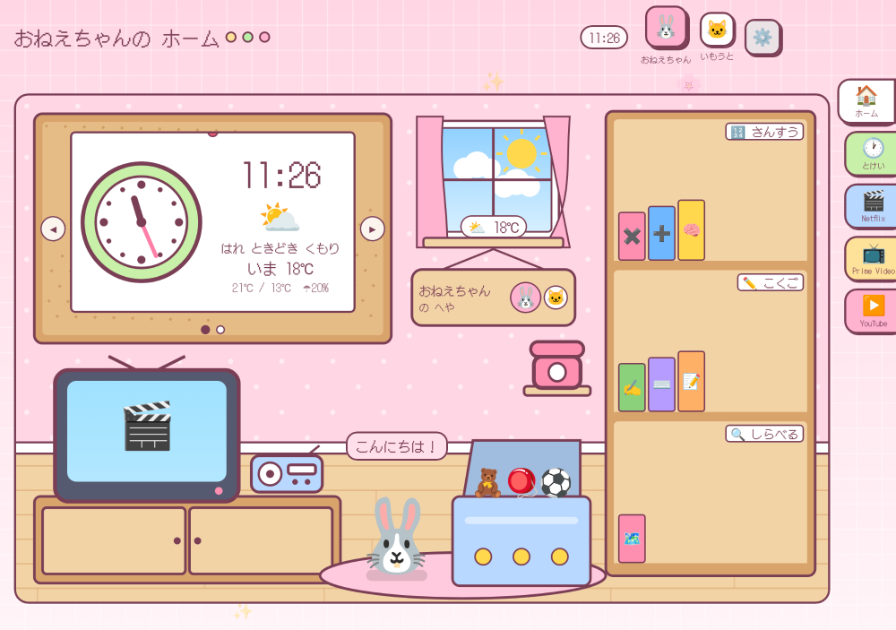

| タブ式ホーム（うさぎ） | どうがロック中（おほしさま） |
| --- | --- |
| 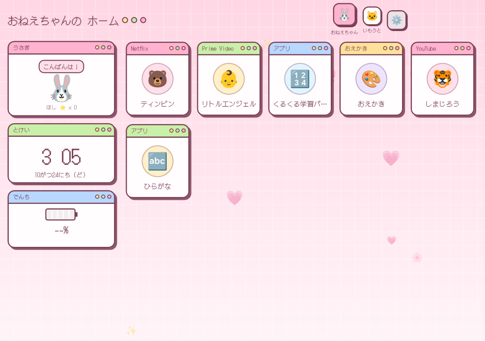 | 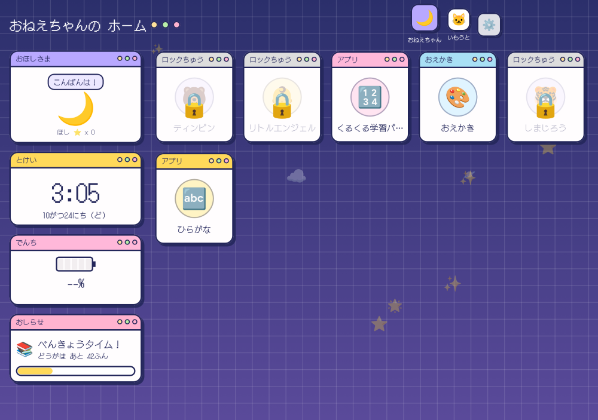 |

| とけい・カレンダー・てんき | おえかき |
| --- | --- |
| 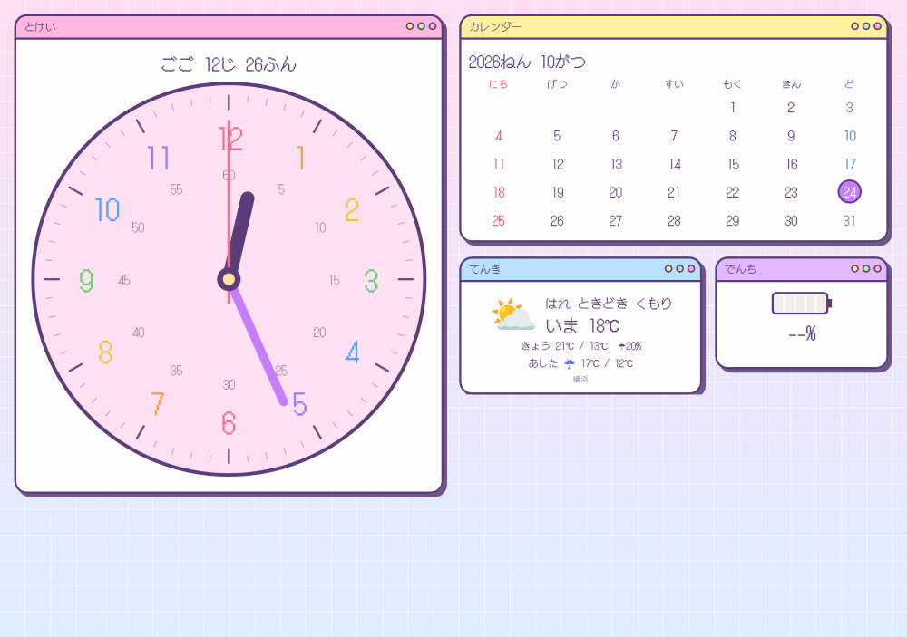 | 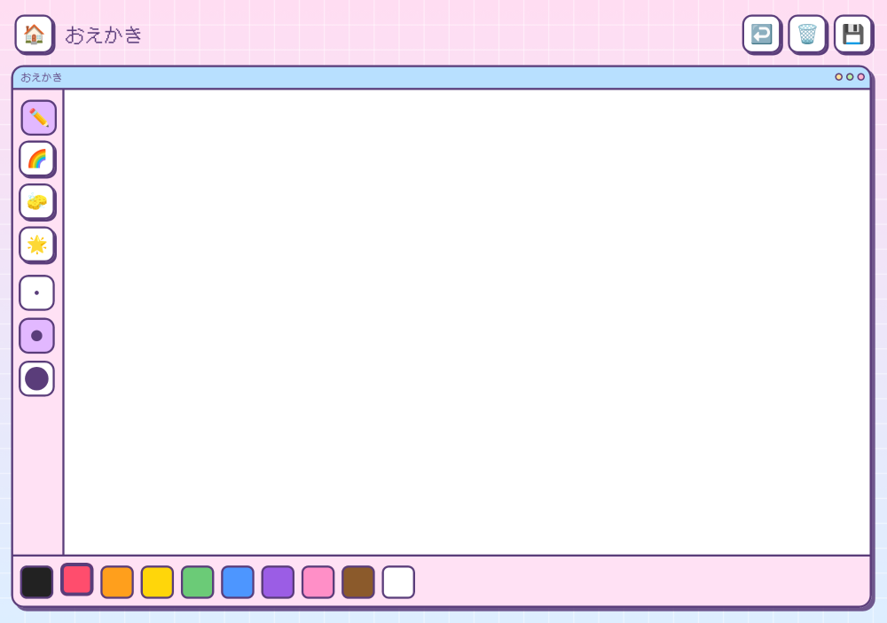 |

| おうちのひとからの呼びかけ | おうちのひと かくにん |
| --- | --- |
| 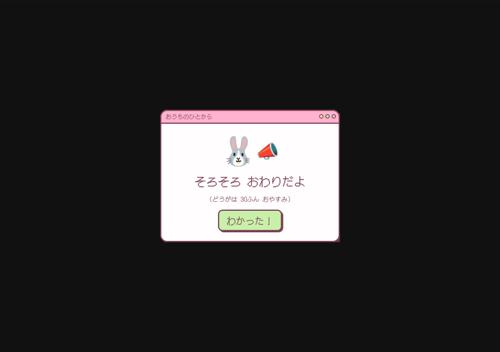 | 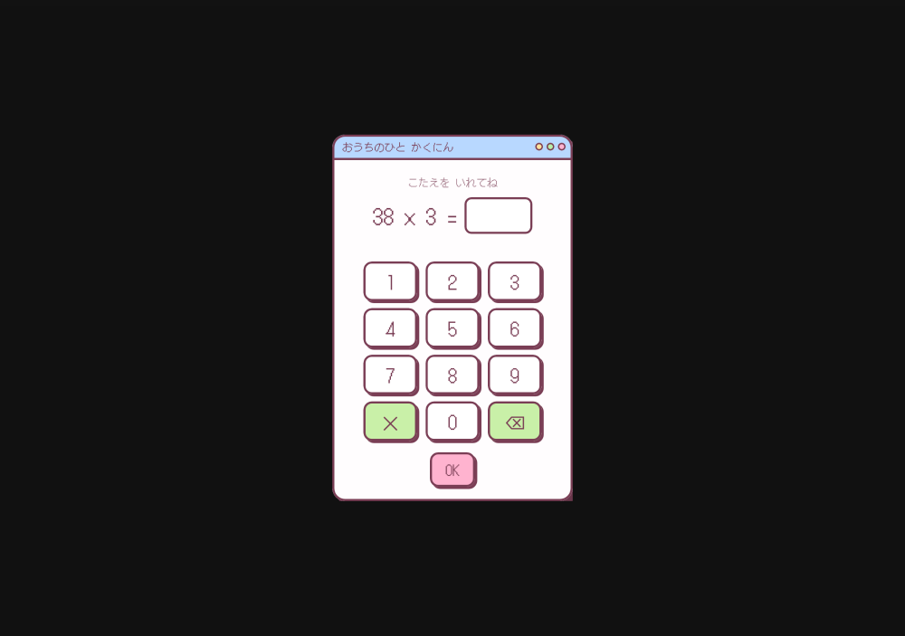 |

## できること

- **画面の右はしのタブ**
  - 🏠 ホーム：アプリ・おえかき・でんわのボタン、マスコット、カレンダー（つき／しゅう、端末の予定つき）、おんがくの ⏮ ⏯ ⏭
  - 📼 ビデオ・🎵 おんがく・🎧 おはなし：本体と SD カードの動画・音楽・オーディオブックを、サムネイルで選んでホームの中で再生
  - 🗂 仕分けたカテゴリー（べんきょう・あそび…）：その子に見せるカテゴリーだけ
  - 🕐 とけい：アナログ時計（ごぜん／ごご・ふん の数字つき）、カレンダー、てんき（Open-Meteo）、でんち
  - 🎬 動画サービスごと（Netflix・Prime Video・YouTube…）：ピン留めした作品と「アプリをひらく」
  - 🧩 ウィジェット：Android のウィジェットを置ける（置いたときだけ出る）
- **📞 でんわボタン**：Google Meet などの通話リンクを置ける（どうがロック中も使える）
- **📣 おうちのひとからの呼びかけ**：スマホのブラウザから「そろそろ おわりだよ」を送ると、動画を見ていてもキッズホームが前に出てマスコットが知らせる。`/lock 30 ごはんだよ` でロックも
- **キャラクターテーマ**：うさぎ / ねこ / くま / きょうりゅう / ユニコーン / うみ / おほしさま
- **こどもごとのホーム**：画面右上のアイコンをタップで切り替え（最大4人）
- **お気に入り動画を直接起動**：Netflix・Prime Video・YouTube・Disney+・TVer などの作品URLをボタンにできる
- **アプリの登録**：くるくる学習パッドなど、使わせたいアプリだけを並べる
- **がっき**（内蔵）：上に ミニけんばん（2 オクターブ、ドレミの色つき）、下に ドラムパッド 8 こ。けんばんは ピアノ／オルゴール／オルガン／もっきん／シンセ、ドラムは ドラム／でんし／たのしい に切り替え。いくつ同時に押しても、指をすべらせても鳴る（音はアプリの中で計算して作る）
- **おえかき**（内蔵）：画材（ペン・いろえんぴつ・クレヨン・すいさい・あぶらえ・スプレー・ゆび・にじ・けしごむ）とスタンプ。描いたものは自動で保存して 📂 から開いて つづきを描ける。🖼️ 写真の上に描く、✨ 写真を Gemini で ぬりえ・クレヨン・すいさい・まんが の絵にしてから描く。🖊️ ペンモード（スタイラスだけで描く・手のひらは無視・筆圧・ペンのおしりで消す）、🖨️ 印刷、💾 写真に保存、📌 ホームに ふせん として貼る
- **わーぷろ**（内蔵）：大きな文字、色・大きさ・紙（むじ・せん・ます）・ドット字、えもじ、🎤 こえ入力、📌 ふせん、🖨️ 印刷、自動保存
- **パズル**（内蔵）：写真・えほんの絵をピースにして はめる（4〜24 ピース、🔄 回転あり、👻 見本の表示）
- **タイピング**（内蔵）：物理キーボードでローマ字入力の練習（特打のように、つぎのキーが光り、押す指を色で教える）。📖 ローマじ ひょう、ホームポジション・あいうえお・どうぶつ・たべもの・のりもの・みじかい ぶん
- **もじ れんしゅう**（内蔵）：マスに ペンで書く（お手本は よこに小さく・田の点線・筆圧・ペンモード）。書いた字は 1 字ずつ保存され、いつのまにか その子の **手書きフォントの素材** が集まる。学年に合わせて漢字が増える（4 月に自動で 1 つ上がる）
- **ふせん**：おえかき・わーぷろ から ホームに貼れる。指で動かす、タップで大きく・はがす
- **どうがロック**：15分〜2時間 / あしたの朝まで。「べんきょうタイム」「ごはんタイム」などの理由を表示
- **おうちのひとメニュー**：⚙️ を **2秒ながおし** → **かけ算**に答える（2けた×1けた、設定で 2けた×2けた）
  - 「📱 すべてのアプリ」：端末のアプリをぜんぶ表示・起動
  - 「⚙️ せってい」：ボタンの登録、どうがロック、アップデート、レスキュー
- **あそび**：マスコットをタップ → ジャンプ・くるりん・おしゃべり／背景をタップ → キラキラ／ときどき歩いてくる いきものをつかまえると ほし⭐
- **自動更新**：1時間に1回まで GitHub Releases を確かめ、新しい版があれば ⚙️ に赤い点。せってい →「アップデートする」
- **レスキュー**：落ちる・固まるのが続くと、自動でレスキュー画面（別のホームを選ぶ／セーフモード／最新版）。通知パネルのクイック設定のタイルからも開ける（開くときもかけ算）

## インストール

1. GitHub の **Actions** タブ → 最新の「Build APK」→ `KidsHome-apk` をダウンロード
   （または Android Studio でこのフォルダを開いて ▶ 実行）
2. zip を展開した `app-debug.apk` をタブレットへ送ってインストール
   （「提供元不明のアプリ」の許可が必要です）
3. ホームボタンを押して **「キッズホーム」→「常時」** を選ぶ
4. ⚙️ を2秒ながおし → かけ算 →「せってい」でボタンを登録

いつでも最新版：<https://github.com/kiwiman0706-beep/Theta.KidsHome.Hatch/releases/latest/download/KidsHome.apk>（0.12.0 から）

> 署名鍵（`app/kidshome.jks`）を同梱しているので、どこでビルドしたAPKでも上書き更新できます。

## QR コード

おやメニュー →「📷 QR コード で せってい・ほかのタブレットへ」

- **📷 QR コードを読む**：カメラで読むと、スプレッドシートのリンク・Gemini の API キー（`AIza…`）・カレンダーの iCal アドレスを見分けて設定します。スプレッドシート・Gemini・カレンダーの各欄にも「📷 QR」ボタンがあります。
- **📲 アプリのダウンロード QR**：新しいタブレットのカメラで読むと、いつでも最新版の APK が落ちてきます（アップデート欄にも同じボタン）。
- **🔁 この設定を QR で渡す**：スプレッドシート・カレンダー（スイッチで Gemini キーも）を `kidshome:setup?…` の QR にまとめ、新しいタブレットの「📷 QR コードを読む」で読ませます。
- 呼びかけのページも「📱 QR で見せる」でスマホに読ませられます。

## お気に入り動画の登録

**いちばん簡単：** Netflix / Prime Video で作品ページを開く → 「共有」→ **「キッズホームに登録」** → かけ算 → 名前と絵文字を選んで登録。

**手動：** おうちのひとメニュー →「🎬 どうがリンクを追加」に作品URLを貼り付け。
例：`https://www.netflix.com/title/80117470`

URL からサービスを判別して、そのアプリで直接開きます（開けないときはブラウザなどにおまかせ）。

## おえかき の画材

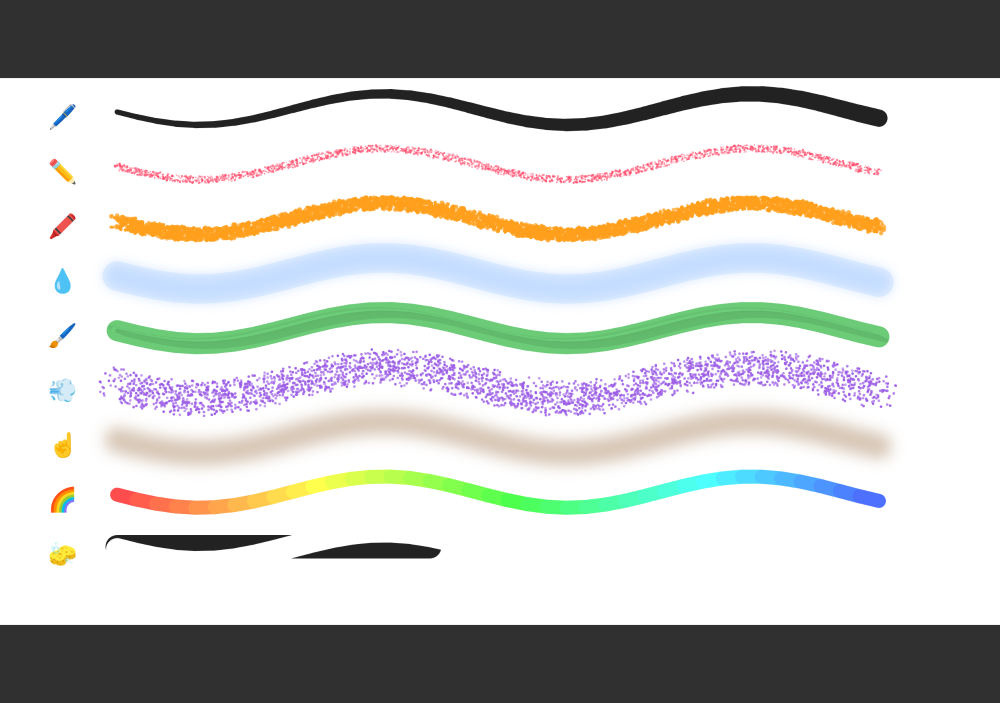

## へや の ホーム

ホームは「その子の へや」。部屋に おくのは 大きな 6 つだけで、押すと 小さな まど で なかみ を えらびます（おやメニュー →「🏠 ホーム」で タブ式にも もどせます）。

| もの | なかみ |
| --- | --- |
| 📋 けいじばん | とけい・てんき／カレンダー（今週と よてい）／じかんわり を 10 びょう ごとに スライド（◀ ▶・スワイプでも） |
| 🪟 まど | 時間と てんき で そら が かわる |
| 📚 ほんだな | 1 だん ＝ おはなし／さんすう（くく・たしざん・くるくる）／こくご（もじ・タイピング・わーぷろ）／しらべる（ちず） |
| 🧸 おもちゃばこ | ショーウインドウ：あそぶ（おえかき・がっき・パズル）・アプリ・仕分けた カテゴリー |
| 📺 テレビ・📻 ラジオ | どうが（ロック中は 🔒 と のこり時間）・おんがく |
| 📞 でんわ | でんわ ボタン |

上の 見出し（とけい・子どもの きりかえ・⚙️ 2 びょう ながおし）と、右はしの ジャンルごとの タブ（とけい・仕分けた カテゴリー・どうがサービス・ウィジェット）は タブ式と おなじ。へや は「🏠 ホーム」タブの なかみ です。中身が ない だん・もの は おきません。「よるは へやを くらくする」は おやメニューで オンに できます（はじめは オフ）。

| ほんだな | おもちゃばこ |
| --- | --- |
| 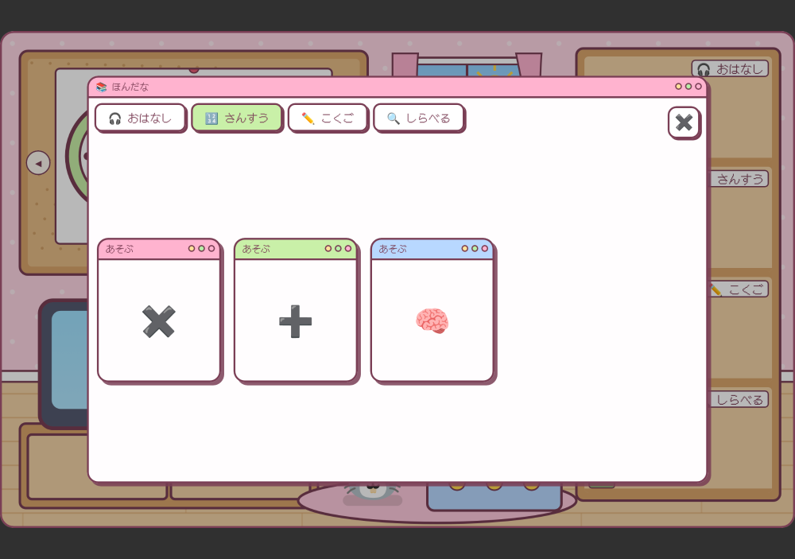 | 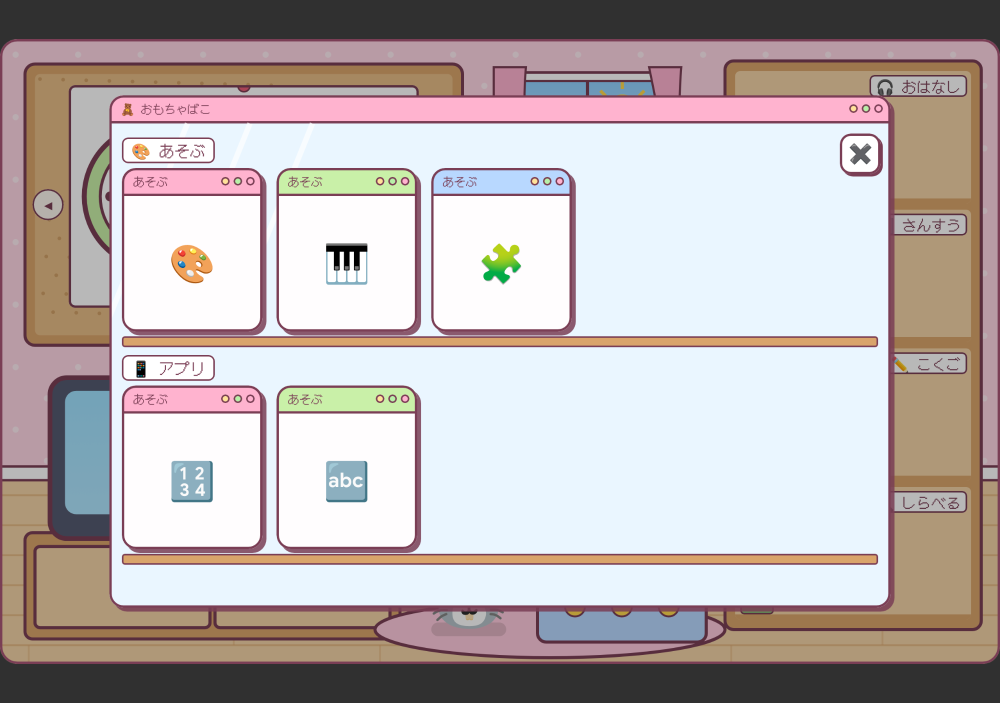 |

## ガイド役（3D キャラ・きせかえ）

へや の マスコットを VRM の 3D キャラに できます（タップで 手をふる・えがお・ジャンプ、まばたき、ゆれもの）。👗 で きせかえ（子どもごと）。
表示は WebView の中の [three.js](https://threejs.org/)（MIT）と [three-vrm](https://github.com/pixiv/three-vrm)（MIT）で、どちらも アプリに同梱（オフラインで動く）。

アプリには デフォルトの「ガイドちゃん」（pixiv の VRM サンプル、VRM Public License 1.0：再配布・改変 可、クレジット不要）が 入っていて、ふく・かみ の 色ちがい で きせかえ できます。
自分の モデルは アプリに入れず、**非公開リポジトリの Release（`guide-pack.zip`）**を 読み取り専用トークンで とってくるか、zip を じかに 読みこみます（おやメニュー →「🧸 ガイド役」）。
パックの作りかた（`manifest.json`・きせかえ スロット・色ちがい・QR の作りかた）は 非公開リポジトリの README に あります。

## がっき

| ふつう | 🎓 れんしゅう |
| --- | --- |
| 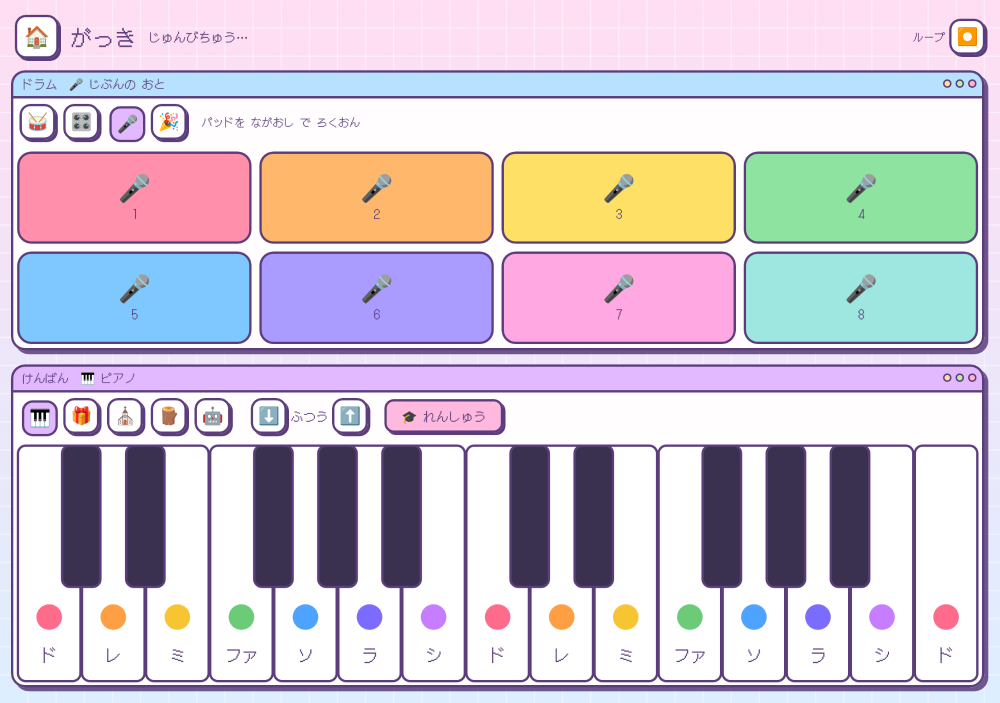 | 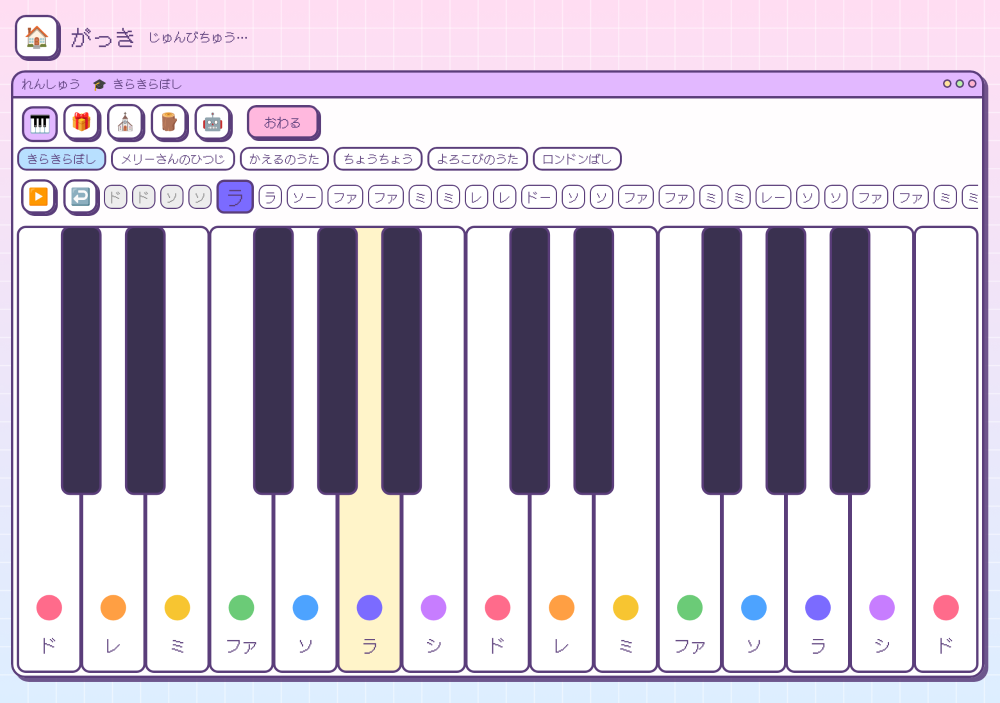 |

上に ドラムパッド、手前（下）に けんばん。

- **🎤 じぶんの おと（サンプラー）**：ドラムのセットで 🎤 を選び、パッドを **ながおし** している間マイクで録音（4 びょうまで）。そのパッドを押すと、録った音が鳴ります。最初の無音は切り、音の大きさをそろえます
- **⏺ ループ**：⏺ を押して パッド・けんばん をたたき、もう一度 ⏺ でその長さを くりかえし再生。くりかえし中に ⏺ で かさねどり、⏸ で止める、🗑️ で消す（録るのは音そのものではなく「どれを いつ押したか」）

**れんしゅう**：曲を選ぶと、次に押す けん が光って、押すまで待ってくれます（片手・1 音ずつ）。上にドレミのならびが出て、いまの音が大きくなります。▶️ でおてほん。
入っている曲は、著作権の切れた童謡・名曲（きらきらぼし・メリーさんのひつじ・かえるのうた・ちょうちょう・よろこびのうた・ロンドンばし）。
せってい →「🎹 ピアノの れんしゅう曲」で、ドレミ書き（例 `ドドソソララソー`、＋で高い音、♯で半音、ーでのばす）で曲を足せます。
著作権のある曲（ミッキーマウス・マーチなど）は同梱していません。家で使う分は、ここから足してください。

## くるくる思考パッド（内蔵）

くるくる思考パッド（回転盤・回転図形・かさねる・積み木 3D・ホワイトボード ほか）を、そのままアプリの中に入れました（`app/src/main/assets/edupad`）。オフラインで動き、ホームの「🧠 くるくる思考パッド」から開きます。
📷 ほぞん・PNG は「写真」へ、バックアップの書き出しは「ダウンロード」へ保存、共有は Android の共有シート、🖨️ は Android の印刷につながります。左下の 🏠 でホームへ。
くるくる思考パッドを更新したときは、`app/` フォルダを `assets/edupad` に置き換えます（`index.html` の 2 か所の印 `kidshome-bridge.js`／`!window.KidsHome` は残す）。

## スタンプ・シール ライブラリ

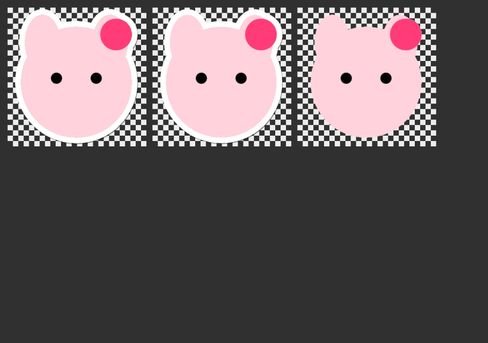

写真や画像から シール を作って、ライブラリにためておきます（おえかき のスタンプ、ホームに うかぶ シール などで使う）。

- 作り方：おえかき の 🌟 →「➕」、または おうちのひと →「🌟 スタンプ・シール ライブラリ」→「＋ シールを つくる」
  1. 📷 写真・画像を選ぶ（持っているシールを撮った写真など）
  2. **✨ かたどり**（Gemini が主役だけを切り抜く。写真は Google に送られます）／ **✂️ まわりを けす**（白い紙などの背景の色を消す）／ **⬜ そのまま**
  3. 🤍 白いフチ（シールの形）あり・なし、なまえ を付けて ライブラリへ
- おえかき：スタンプの列に ライブラリのシールが並ぶ（大きさは 3 だん）。🏠 で そのシールを ホームに うかべる
- ホーム：うかべた シールは ふわふわ動き、指で動かせる。タップで大きく・はがす
- 書き出し・読み込み：ZIP（index.json と PNG）。ほかの端末・ほかの機能でも同じ形で使えます
- 市販のシールの写真から作ったものは、家の中だけで使ってください（ZIP を人に配らない）

## もじ れんしゅう（手書きフォントの素材あつめ）

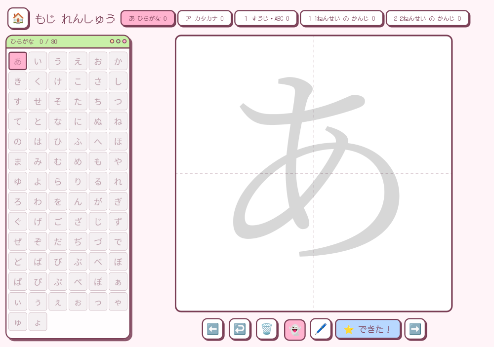

- ひらがな・カタカナ・すうじ と、**学年別漢字配当表（2020 年度からの 1026 字）** のうち その子の学年までの漢字。学年は「こどもごとの設定」で選び、4 月に自動で 1 つ上がります
- 書いた字は その子の字で一覧に並び、まだの字に自動で進みます
- 書き出し：おうちのひと →「✍️ 手書きフォントの素材」
  - **おれん字 PDF**：おれん字 てがき と同じ用紙（A4 横・20×10 マス・※とメモ枠）に、書いた字をそのマスへ。書いた字のあるシートだけ
  - **ZIP**：PNG（512px 透過）・SVG・線のデータ（strokes.json、おれん字 てがき と同じ形式）
- 都道府県名の 11 字（茨・媛・岡・熊・埼・鹿・栃・奈・梨・阪・阜）は おれん字 の用紙に無いので、PDF には出ず ZIP にだけ入ります
- 漢字の学年は [learned-kanji](https://www.npmjs.com/package/learned-kanji)（MIT、学年別漢字配当表 平成29年告示）から、用紙の文字の並びは おれん字 てがき から

## くくの ひょう

9×9 のます。

- 「〇のだん」を押すと その段を、うえの すうじ を押すと たての ならびを、順に読み上げます（読んでいる ます が光る）。
- ます を押すと「さざんが く」と読み上げ、右に 式・となえかた・まるの図（3 が 4 こぶん）を大きく出します。
- 🙈 かくす：答えが ★ にかくれ、押すと ひらきます。🎲 もんだい で まだ ひらいていない ます を出題（「さざんが…」まで読む）。もう一度 🙈 で ぜんぶ かくしなおし。
- 🐢 で ゆっくり読み上げ。読み上げは端末の「音声読み上げ」（日本語）を使います。

## たしざん の ひょう

くくの ひょう と おなじ 形（読み上げなし）。「1〜9」と おうようの「11〜20」（11〜20 に 1〜9 を たす）。
🙈 かくす・🎲 もんだい も おなじ。右に 10 の わく（ピンク＝たされる数、みずいろ＝たす数）と「10 と 3 で 13」。

## ちず

おうち・がっこう・あそびに いく ところ を ピンで出して、ちりの かんかく を そだてます。

- 地図は 国土地理院（🗾 ちず／🌫️ うすい）と OpenStreetMap（🌍 OSM）を切り替え。🏡 おうちへ・📍 いまここ（おおよその位置）・🗾 日本ぜんたい。
- ばしょを押すと「おうちから まっすぐ ○キロ」。みちを調べてあれば「みちのり ○キロ・くるまで ○ふん」と、🚗 いきかた で 道を なぞるように かきます。
- ✏️（おうちのひと かくにん）で へんしゅう：地図を ながおし か 🔍 さがす で ばしょを ふやす（えもじ・メモ・「ここが おうち」）、ピンを押して なおす・🚗 おうちからの みちを しらべる。
- 🛣️ せん：高速道路・線路・川 を なまえで さがして、色つきの線と なまえ札で かさねます（例：東名高速道路、東海道新幹線、多摩川）。右の「せん」で 見せる・かくす。
- データ：検索 Nominatim、みち OSRM（routing.openstreetmap.de）、線 Overpass（どれも © OpenStreetMap contributors）、地図 地理院タイル。データはタブレットの中（map.json）に保存。

## じかんわり

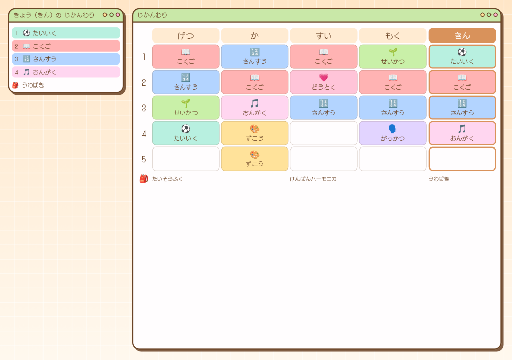

せってい →「こどもごとの設定」で、ようびごとに 1〜6 じかんめ と もちもの を入れます（スプレッドシートの「じかんわり」表からも）。
ホームに「きょう（15 時からは あした）の じかんわり」ともちもの、右はしに「📒 じかんわり」のタブ（1 しゅうかんの表、きょうの列が光る）が出ます。

## Hatch シリーズ

せってい →「🥚 Hatch シリーズのアプリ」から、おえかきハッチ（Theta.Oekaki.Hatch）を GitHub Releases から入れる・更新する・ひらく ことができます（取得 → SHA-256 照合 → インストール画面）。

## カレンダー（Google カレンダー）

ホームのカレンダー（つき／しゅう）に予定を出す方法は 2 つ。せってい →「📼 端末の動画・音楽・おはなし」のカレンダーのところ。

- **Google カレンダーの iCal アドレス（おすすめ）**：パソコンの Google カレンダー → 設定 → 見せたいカレンダー →「iCal 形式の非公開アドレス」を貼る。子どものタブレットに Google アカウントを入れずに、家族のカレンダーを読むだけで出せます（いくつでも、スプレッドシートの「せってい」に `カレンダー｜URL` でも）。くりかえしの予定にも対応
- **この端末のカレンダー**：タブレットに入っている Google アカウントのカレンダー（許可が必要）

## Android TV

Android TV（Google TV）にも入れられます。TV のアプリ一覧に横長のアイコンで出て、ホームアプリにもできます。
リモコンの十字キーで ボタン・タブ を選べます（選んでいるものは太い枠）。おうちのひとメニューは ⚙️ を選んで **決定ボタンを 2 秒ながおし** → かけ算。
おえかき・がっき・くるくる思考パッド はタッチが前提なので、TV では動画・音楽・おはなし・アプリの起動が中心になります。

## 端末の動画・音楽・おはなし

| ビデオ | おんがく・おはなし |
| --- | --- |
| 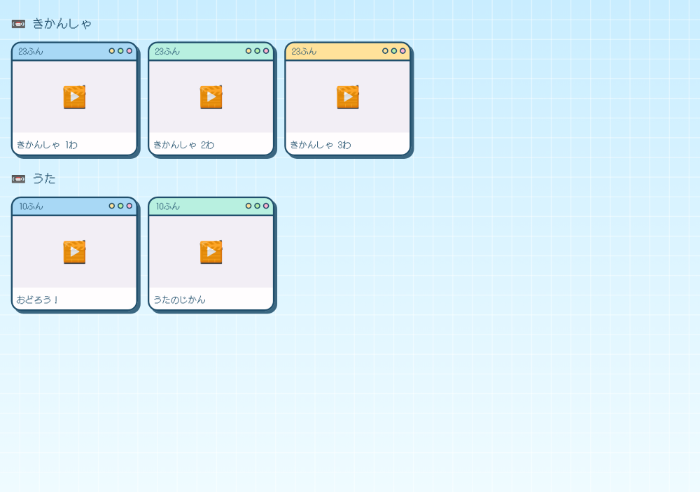 | 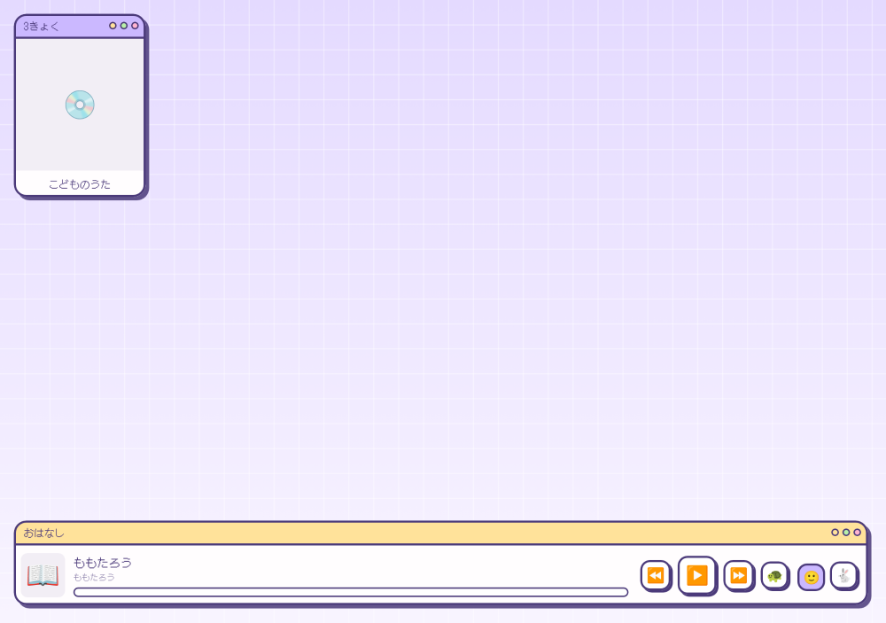 |

せってい →「📼 端末の動画・音楽・おはなし」で、動画と音楽へのアクセスを許可します。

- **ビデオ**：フォルダごとの「たな」に、動画のコマをサムネイルで並べます。押すとホームの中で再生し、同じたなの動画を続けて再生します。前に見たところから続きを再生し、見たところまでを赤い線で表示します。どうがロックの対象で、ロックが始まると止まってホームに戻ります。
- **おんがく**：アルバムごと（ジャケットつき）。ほかのアプリに行っても鳴り続け、通知や車のボタンでも操作できます。
- **おはなし（オーディオブック）**：`.m4b`、または「Audiobooks」「オーディオブック」「おはなし」というフォルダの音声。続きから再生し、30 秒もどす／すすむ、速さ（🐢・🙂・🐇）を変えられます。
- カメラで撮った動画などは、フォルダごとに「かくす」にできます（Camera・Screenshots などは初めからかくしています）。
- 再生は Google の Media3（ExoPlayer）。再生できない形式は、VLC が入っていれば「VLC で みる」が出ます。

## アプリの仕分け（見せる・かくす）

せってい →「🗂 アプリの仕分け」の「仕分けガイド」、または「すべてのアプリ」の「仕分け N」（N は未分類の数）。

1. **カテゴリーを用意**：べんきょう・あそび・どうが・おんがく・えほん・つくる・しゃしん・おうちのひと（見せない）から選ぶ。自分で作ることもできる
2. **1 つずつ振り分け**：アプリが大きく出るので、入れるカテゴリーか「🙈 かくす」を押すと次へ。おすすめは枠が太い。「もどす」「あとで」「ここで終わる」

カテゴリーごとに **どの子に見せるか** と **どうが扱い（ロック対象）** を選べます。見せるカテゴリーは、その子のホームの右はしにタブで出ます。
**未分類と「かくす」のアプリは、どの子にも出ません**（新しく入れたアプリも、仕分けるまでは出ません）。

## 親のスマホから設定（Google スプレッドシート）

タブレットにログインは要りません。親のシートを「リンクを知っている全員（閲覧者）」で共有し、そのリンクをタブレットに貼るだけです。

1. せってい →「📝 親のスマホから設定」→「いまの設定を書き出す」→ Google ドライブに保存
2. ドライブで開いて「Google スプレッドシートとして保存」
3. 共有 →「リンクを知っている全員」（閲覧者）→ リンクをコピーして、タブレットに貼る

以後はスマホでシートを書き換えると、タブレットが 15 分ごと（とホームに戻ったとき）に読み込みます。電波が無いときは前の内容のまま。

| シート | 1 行目 | 書き方 |
| --- | --- | --- |
| こども | なまえ・テーマ | テーマは うさぎ／ねこ／くま／きょうりゅう／ユニコーン／うみ／おほしさま |
| ボタン | こども・しゅるい・なまえ・URL・アプリ・えもじ・どうが | こども は名前か「ぜんいん」。しゅるい は どうが／アプリ／おえかき／がっき／くるくる／でんわ／わーぷろ／パズル／タイピング／もじ／くく／たしざん／ちず。アプリはパッケージ名かアプリ名 |
| カテゴリー | なまえ・えもじ・みせる・どうが | みせる は「ぜんいん」「おねえちゃん, いもうと」、空なら見せない。どうが に ○ でロック対象 |
| アプリ | アプリ名・パッケージ・カテゴリー | カテゴリー名か「かくす」。空なら未分類（出さない） |
| じかんわり | こども・ようび・1〜6・もちもの | ようび は げつ／か／すい／もく／きん／ど（「月」「水曜」でも可） |
| せってい | こうもく・あたい | かけ算＝ふつう／むずかしい、てんき＝地名／いまいるところ／なし |

ウィジェット・おんがくアプリ・呼びかけ・どうがロックはタブレットだけの設定です（どうがロックは呼びかけの `/lock 30` が便利）。呼びかけのページのアドレスはシートに入れません。

## おうちのひとからの呼びかけ

1. せってい →「📣 おうちのひとからの呼びかけ」をオン
2. 「他のアプリの上に重ねて表示」を許可（動画を見ている最中でも前に出すため）
3. 「このリンクを自分のスマホへ送る」で、送るページ（`https://ntfy.sh/kidshome-…`）を自分のスマホへ
4. そのページで文字を送る：
   - `そろそろ おわりだよ` … 呼びかけだけ
   - `/lock 30 ごはんだよ` … どうがを30分ロックして呼びかけ
   - `/unlock` … ロック解除

中継には公開サービス ntfy.sh を使います（アカウント不要）。ページのアドレスを知っている人は誰でも送れるので、人に教えないでください。
タブレットには「呼びかけを待っています」という通知が出たままになります（常駐のため）。

## 制限について（大事）

このアプリは「ホームに出すものを絞る」タイプの制限です。Android の仕組み上、以下は防げません。

- 通知バーからの設定変更、最近使ったアプリ一覧からの切り替え
- 動画アプリの中で別の作品を探すこと

しっかり縛りたい場合は、あわせて次を使うのがおすすめです。

- **Google ファミリーリンク**：アプリのインストール制限・利用時間
- **Netflix のキッズプロフィール** / **Prime Video のキッズプロフィール**
- Android の **アプリ固定（画面の固定）**

## 新しい版の出し方（自動更新）

1. `app/build.gradle.kts` の `versionCode` と `versionName` を上げる
2. GitHub の Actions →「Release APK」→ Run workflow → 版（例 `v0.2.0`）を入れて実行
3. Release に `KidsHome-<版>.apk` と `SHA256SUMS.txt` が載り、タブレットが自動で見つけます

## フォント

ドット文字は [DotGothic16](https://fonts.google.com/specimen/DotGothic16)（SIL Open Font License、[licenses/](licenses/DotGothic16-OFL.txt)）。

## 開発メモ

- Kotlin + Jetpack Compose、minSdk 29 / targetSdk 35
- 設定は SharedPreferences に JSON で保存（`data/Store.kt`）
- テーマは `ui/Themes.kt` の `KidThemes` に追加するだけで増やせます
